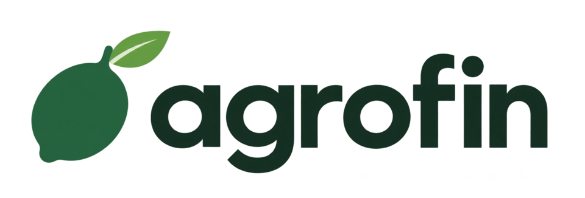
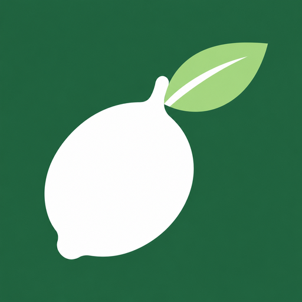
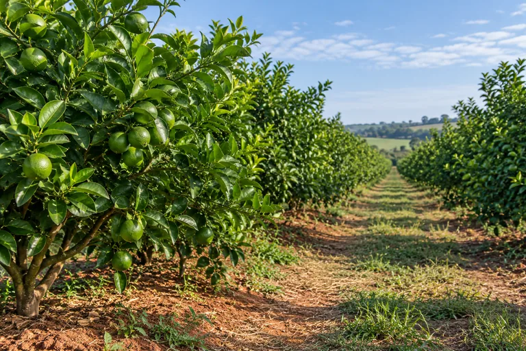
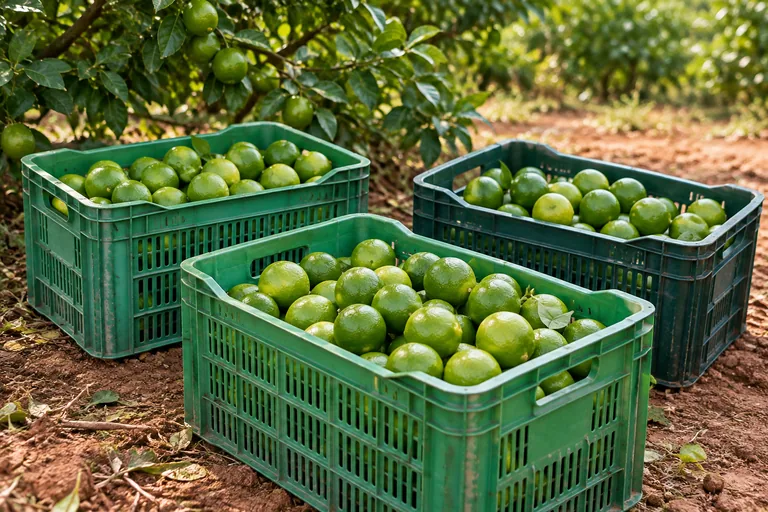
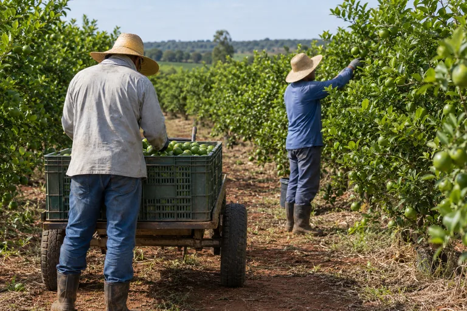
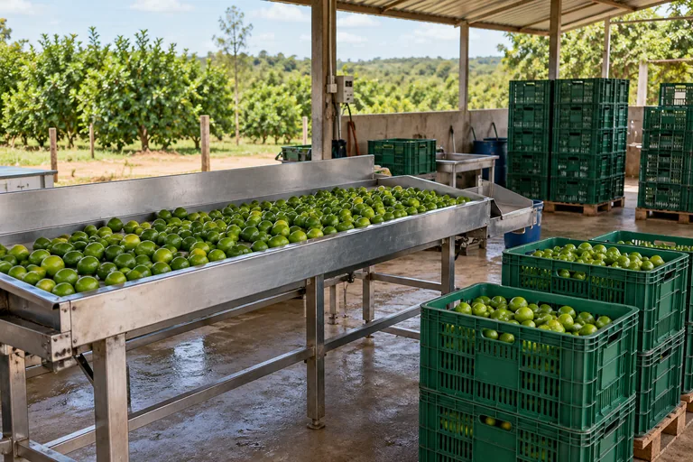
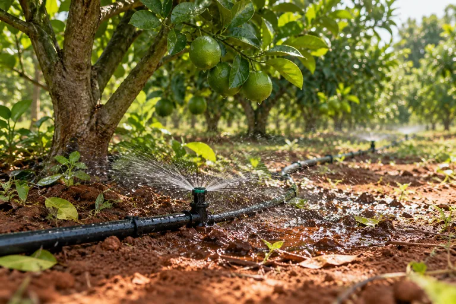
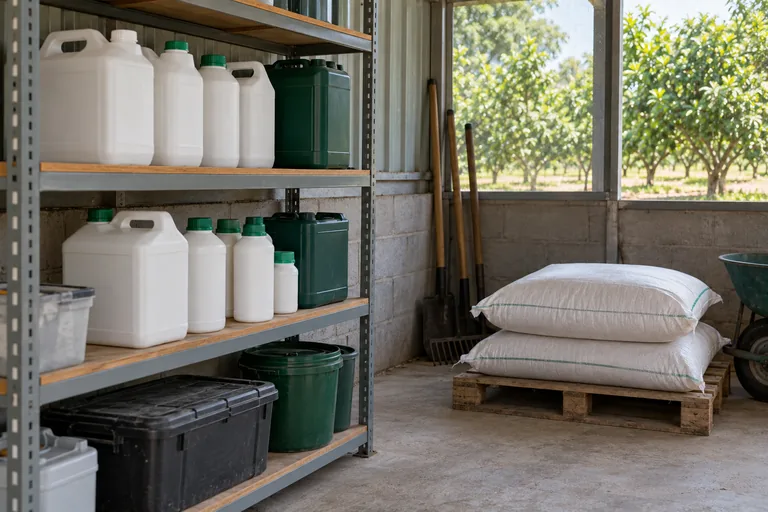
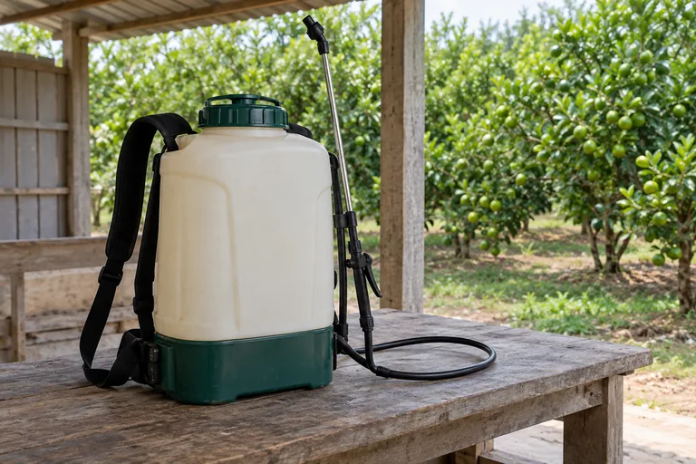
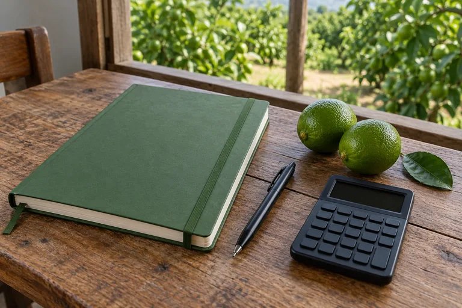

# Imagens do frontend

Conjunto de 10 imagens criado a partir do [contexto](../../../CONTEXT.md), dos [requisitos](../../../docs/requisitos.md) e dos [fluxos mobile](../../../docs/fluxos-mobile.md): uma logo, um ícone e oito fotografias sintéticas com aparência documental da produção de limão. Geração pela ferramenta integrada `image_gen`, sem CLI ou API externa configurada no projeto. Os [prompts completos](prompts-imagens.json) permitem revisar e gerar variações.

As cenas representam atividades plausíveis do produto. São imagens geradas, sem retratar o cliente, seus funcionários ou sua propriedade. Os usos abaixo são sugestões visuais para as telas previstas na documentação; a disponibilidade de uma imagem não significa que o fluxo já foi implementado.

## Arquivos e usos

Os arquivos ficam em `apps/web/public/images/`. O Vite os publica em `/images/`, preservando os nomes. A marca acompanha os verdes do tema claro existente. A logo já aparece no cabeçalho, o ícone está aplicado à aba do navegador e à opção de adicionar à tela inicial, e o pomar aparece na página inicial.

| imagem | arquivo | uso sugerido |
| --- | --- | --- |
| logo | [logo-agrofin.png](../public/images/marca/logo-agrofin.png) | cabeçalho e futura tela de entrada; PNG 960 × 326 com transparência |
| ícone | [icone-agrofin.png](../public/images/marca/icone-agrofin.png) | símbolo da marca; PNG 512 × 512 com fundo verde |
| pomar | [pomar-de-limao.webp](../public/images/fotos/pomar-de-limao.webp) | boas-vindas e contexto da produção |
| caixas | [caixas-da-colheita.webp](../public/images/fotos/caixas-da-colheita.webp) | colheita e caixas registradas |
| equipe | [equipe-na-colheita.webp](../public/images/fotos/equipe-na-colheita.webp) | cadastro de funcionários e equipe |
| barracão | [venda-ao-barracao.webp](../public/images/fotos/venda-ao-barracao.webp) | vendas e entrega de caixas |
| irrigação | [irrigacao-do-pomar.webp](../public/images/fotos/irrigacao-do-pomar.webp) | despesas de irrigação e energia |
| insumos | [estoque-de-insumos.webp](../public/images/fotos/estoque-de-insumos.webp) | compras e estoque de insumos |
| pulverização | [equipamento-de-pulverizacao.webp](../public/images/fotos/equipamento-de-pulverizacao.webp) | registro e histórico de pulverizações |
| planejamento | [planejamento-da-producao.webp](../public/images/fotos/planejamento-da-producao.webp) | futuros resumos, relatórios e planejamento |

As oito fotos são WebP de 1536 × 1024. Cada uma tem também uma versão de 768 × 512 com o sufixo `-768.webp`. As versões menores pesam aproximadamente 57–127 KiB; as maiores, 151–345 KiB. Os arquivos [favicon.ico](../public/favicon.ico) (16, 32 e 48 pixels) e [apple-touch-icon.png](../public/apple-touch-icon.png) (180 pixels) são derivados do mesmo ícone, sem representar novas imagens do conjunto.

## Uso no react

```tsx

```

O exemplo considera o contêiner atual, com largura máxima de 896 pixels e 40 pixels de recuo horizontal. Ajuste `sizes` à largura real quando a imagem aparecer em um card. Use `alt=""` quando a foto apenas decorar um conteúdo já explicado pelo texto. Fotos fora da primeira tela podem usar `loading="lazy"`; a imagem principal visível ao abrir a página deve carregar normalmente. Declare as dimensões para reservar espaço durante o carregamento.

As fotos servem como apoio visual. Nomes, quantidades, valores financeiros, classificações de caixas e fases da Lua devem continuar em elementos de interface acessíveis e ligados aos dados do sistema. A imagem de pulverização mostra somente o equipamento e não representa recomendação de produto, dose ou data de aplicação.

## Prévias

### Logo e ícone





### Pomar



### Colheita



### Equipe



### Barracão



### Irrigação



### Insumos



### Pulverização



### Planejamento


