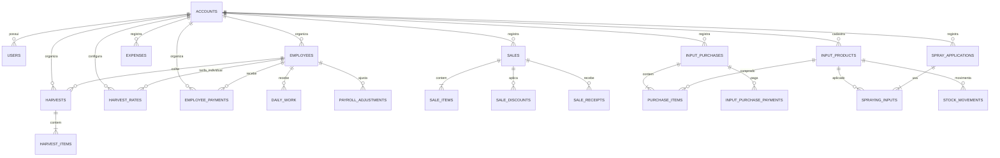

# modelo de dados inicial

Este documento detalha uma proposta de banco para os requisitos e fluxos atuais. O modelo ainda não está implementado; nomes, restrições e migrações devem ser confirmados durante o primeiro fluxo funcional. PostgreSQL é a recomendação inicial por causa das relações, transações e consultas por período; o provedor continua em aberto.

## princípios do modelo

- Usar registros relacionais com chaves estrangeiras para preservar os vínculos entre conta, funcionário, lançamento, compra e estoque.
- Atribuir um `account_id` aos dados do negócio. Mesmo com uma conta administradora no primeiro escopo, isso deixa explícita a fronteira de autorização e reduz o risco de misturar dados se o sistema crescer.
- Gerar IDs UUID para registros. Usar `DATE` para datas da operação e `TIMESTAMPTZ` em UTC para horários técnicos; apresentar datas no fuso configurado para a operação, inicialmente `America/Sao_Paulo`.
- Manter os registros de negócio simples: o cadastro de funcionário pede apenas o nome; o identificador e o estado ativo/inativo são técnicos.
- Guardar o valor monetário aplicado no momento do lançamento para que mudanças de tarifa ou preço não alterem o histórico.
- Preferir saldos calculados a saldos editáveis. Isso é especialmente importante para pagamentos, recebimentos e estoque.

## entidades recomendadas

Os nomes abaixo são nomes de tabela sugeridos, não um contrato definitivo de implementação.

| tabela | campos e relações principais | responsabilidade |
| --- | --- | --- |
| `accounts` | `id`, `name`, `timezone`, `created_at` | Delimita os dados de uma operação. |
| `users` | `id`, `account_id`, credencial protegida, estado | Acesso do cliente. Senhas devem ser armazenadas com hash próprio para senhas, nunca cifradas reversivelmente. |
| `employees` | `id`, `account_id`, `name`, `active`, `deactivated_at` | Cadastro mínimo de funcionários. Desativar preserva o histórico. |
| `harvest_rates` | `id`, `account_id`, `employee_id` opcional, `box_type`, valor cifrado, `valid_from`, `valid_until` | Tarifas por tipo de caixa e vigência. Funcionário opcional permite representar uma tarifa geral ou uma tarifa individual. |
| `harvests` | `id`, `account_id`, `employee_id`, `harvest_date`, `created_by` | Cabeçalho de um lançamento de colheita para uma pessoa e uma data. Não restringir a um único cabeçalho por dia; isso permite correções e mais de um lançamento sem sobrescrever dados. |
| `harvest_items` | `id`, `account_id`, `harvest_id`, `box_type`, `quantity`, tarifa unitária aplicada cifrada | Uma linha por tipo de caixa (`normal` ou `moagem`). A quantidade é inteira e positiva. A tarifa aplicada fica fotografada na linha. O total pode ser calculado no Go a partir da quantidade e da tarifa. |
| `daily_work` | `id`, `account_id`, `employee_id`, `work_date`, valor cifrado, observação | Registra uma diária separada da produção por caixas; não cria caixas fictícias. |
| `employee_payments` | `id`, `account_id`, `employee_id`, `period_start`, `period_end`, `paid_at`, valor cifrado, observação | Registra pagamentos parciais ou integrais ligados ao período do funcionário. O mesmo período pode ter vários pagamentos. |
| `payroll_adjustments` | `id`, `account_id`, `employee_id`, período, tipo, valor cifrado, motivo | Ajustes explícitos quando uma correção afeta período já pago. A regra de carregar crédito ou débito para outro período ainda precisa ser definida. |
| `sales` | `id`, `account_id`, `sold_at`, `buyer_name`, observação | Cabeçalho do acerto com o barracão. Um texto para o comprador basta enquanto houver apenas um; tabela de compradores pode ser criada se surgirem vários. |
| `sale_items` | `id`, `account_id`, `sale_id`, `sale_type`, `quantity`, preço unitário cifrado | Linhas de exportação, mercado ou moagem. Não são deduzidas das caixas da colheita. |
| `sale_discounts` | `id`, `account_id`, `sale_id`, motivo, valor cifrado | Descontos separados do preço original; o desconto total não pode exceder o valor bruto. |
| `sale_receipts` | `id`, `account_id`, `sale_id`, `received_at`, valor cifrado | Recebimentos, inclusive parciais. |
| `expenses` | `id`, `account_id`, `paid_at`, categoria, descrição, valor cifrado | Despesas gerais pagas, como energia de irrigação e outros custos. |
| `input_products` | `id`, `account_id`, `name`, categoria, unidade padrão, estado do controle de estoque | Cadastro de fertilizantes e defensivos. O controle pode ficar pendente quando o saldo inicial for desconhecido. |
| `input_purchases` | `id`, `account_id`, `purchased_at`, fornecedor opcional, observação | Cabeçalho de uma compra de insumos. A data da compra fica separada da data em que foi paga. |
| `purchase_items` | `id`, `account_id`, `purchase_id`, `product_id`, quantidade, unidade, custo unitário cifrado | Detalha o que entrou no estoque e o custo por produto. |
| `input_purchase_payments` | `id`, `account_id`, `purchase_id`, `paid_at`, valor cifrado | Registra saídas de caixa de compras, permitindo pagamento imediato, parcial ou a prazo. Para compra imediata, cria-se um pagamento junto com a compra. |
| `spray_applications` | `id`, `account_id`, `applied_at`, observações | Evento de pulverização que aparece no histórico e no calendário. |
| `spraying_inputs` | `id`, `account_id`, `spray_application_id`, `product_id`, quantidade usada, unidade | Insumos usados em uma pulverização. Permite cadastrar e selecionar um novo produto sem perder o formulário atual. |
| `stock_movements` | `id`, `account_id`, `product_id`, data, quantidade positiva ou negativa, unidade, origem e referência | Livro de movimentos de estoque: compra, saldo inicial, uso ou ajuste. O saldo vem da soma dos movimentos válidos. |
| `audit_events` | `id`, `account_id`, autor, data, entidade, operação, dados anteriores e posteriores protegidos | Trilha para correções relevantes sem apagar silenciosamente o histórico. Valores financeiros dentro do registro de auditoria também precisam ser cifrados. |

## relações principais

Todas as tabelas de negócio pertencem a uma conta. Recomenda-se que as referências entre essas tabelas também validem o `account_id` — por exemplo, uma colheita não pode apontar para um funcionário de outra conta. Na primeira versão, uma conta terá o usuário administrador; uma tabela de membros e perfis pode entrar quando o acesso de outras pessoas for confirmado.

## regras e invariantes

- Colheita usa apenas `normal` e `moagem`; venda usa apenas `exportação`, `mercado` e `moagem`. São classificações de etapas distintas.
- Um dia sem colheita não cria falta, penalidade ou desconto.
- Uma tarifa tem vigência. Uma alteração não recalcula colheitas anteriores. A tabela permite tarifa geral e individual; qual delas prevalece se ambas existirem ainda precisa ser confirmado.
- Pagamento semanal é calculado por funcionário e período: caixas + diárias − pagamentos + ajustes aplicáveis. O início da semana ainda precisa ser escolhido.
- O servidor deve bloquear pagamento acima do saldo devido, salvo ajuste explícito. Correção em período já pago deve destacar a diferença e deixar registro rastreável.
- Venda bruta é a soma das linhas; venda líquida é o bruto menos descontos; a receber é o líquido menos recebimentos. Valores vendidos e recebidos aparecem separadamente.
- Saldo de caixa soma somente dinheiro efetivamente recebido e pago no período. Não deve ser apresentado como lucro contábil.
- Compras de insumos geram entrada de estoque. Pulverizações geram saídas de estoque, mas não uma nova despesa pela compra já registrada.
- `stock_movements` é a fonte para o saldo do estoque; não persistir um saldo editável paralelo. Compra, uso e movimento correspondente devem ser gravados na mesma transação.
- No primeiro escopo, usar uma unidade padrão por insumo. Conversões entre unidades só devem ser modeladas quando os usos reais forem definidos.
- Fase lunar não precisa de tabela própria no primeiro escopo: pode ser calculada ou consultada por data. A fonte e a necessidade de guardar uma fotografia histórica continuam em aberto.
- Movimentações financeiras, estoque e ajustes precisam ser transacionais. Quantidades e valores devem ser validados no servidor, mesmo quando a interface mostra uma prévia.
- Restringir linhas de colheita a uma linha por tipo em cada cabeçalho e exigir quantidade positiva. Aplicar validações equivalentes de quantidade nas linhas de venda e pulverização.
- Impedir sobreposição de vigências para a mesma combinação de tipo e escopo da tarifa. Se houver tarifa geral e individual, a resolução da precedência precisa ser definida antes de aplicar essa restrição.
- Validar pagamentos e descontos junto com o saldo correspondente dentro de transação; duas gravações concorrentes não podem ultrapassar o saldo devido ou o valor bruto.

## proteção dos valores financeiros

O cenário protegido é o vazamento isolado de uma cópia do banco: a cópia não deve revelar tarifas, preços, descontos, pagamentos, recebimentos, custos de compra ou despesas. A criptografia ocorre na aplicação Go antes da persistência.

- Durante os cálculos, representar dinheiro em centavos inteiros (`int64`), sem ponto flutuante. Cifrar a representação antes de gravar; no banco, guardar bytes cifrados, nonce e versão/identificador da chave conforme o formato escolhido.
- Usar criptografia autenticada de uma biblioteca mantida, como AES-GCM quando adequado ao ambiente. A OWASP recomenda algoritmos estabelecidos, modos seguros e separação entre as chaves e os dados cifrados; a implementação também precisa respeitar a unicidade de nonce e os limites do modo escolhido. [OWASP Cryptographic Storage](https://cheatsheetseries.owasp.org/cheatsheets/Cryptographic_Storage_Cheat_Sheet.html)
- Manter as chaves fora do banco e do controle de versão, com plano de rotação e recuperação. A estratégia concreta de gerenciamento de chaves para o deploy ainda não foi escolhida. Backups do banco não devem conter a chave necessária para decifrar os dados.
- Cifrar também valores em auditorias e agregados persistidos. Não gravar valores financeiros em logs, erros, telemetria ou métricas sem proteção.
- Senhas usam hash próprio para senhas, não a criptografia reversível usada para valores financeiros.
- Datas, quantidades, classificações, IDs e categorias ainda podem ficar visíveis. Essa exposição de metadados é uma limitação deliberada do modelo inicial e deve ser considerada na avaliação de privacidade.

Como a cifra autenticada não permite somas SQL comuns e valores iguais geram textos cifrados diferentes, a API deve filtrar primeiro por conta autorizada e intervalo de datas, decifrar apenas o necessário e calcular os relatórios no servidor. Não persistir cópias em texto claro para facilitar `SUM`, busca ou ordenação por valor. A implementação futura deve testar confidencialidade do banco de teste e restauração com a chave correta.

## decisões confirmadas e pontos em aberto

### regras já estabelecidas

- Funcionário informa somente o nome; o sistema gera o ID e permite desativação preservando o histórico.
- Pagamento por caixa distingue normal e moagem; venda distingue exportação, mercado e moagem.
- Diária é excepcional e separada das caixas. Ausência de lançamento não gera punição.
- Vendas, recebimentos, pagamentos de funcionários e despesas precisam ser apresentados como medidas diferentes.
- Valores financeiros persistidos precisam ser protegidos contra vazamento isolado do banco.

### recomendações deste modelo

- Usar banco relacional, com PostgreSQL como candidato inicial, sem escolher ainda um provedor.
- Colocar `account_id` nos registros de negócio para delimitar autorização e dados.
- Guardar tarifas aplicadas na colheita e calcular saldos semanais e de estoque a partir dos lançamentos.
- Separar compra de insumo de pagamento da compra, mesmo que a primeira versão crie os dois juntos para compras à vista.
- Calcular relatórios na API depois da descriptografia.

### decisões que continuam pendentes

- Qual dia inicia a semana de pagamento.
- Se tarifas variam por funcionário e como resolver a precedência entre tarifa geral e individual.
- Se o barracão informa diretamente a classificação da venda e se há mais de um comprador.
- Se compras a prazo ou pagamentos parciais de compra acontecem na prática.
- Quais unidades são usadas no estoque e se serão necessárias conversões.
- Qual fonte lunar será usada e se é preciso exibir o horário exato das transições.
- Se haverá uso sem internet ou acesso por mais pessoas.
- Como tratar crédito ou débito de funcionário quando uma semana já paga for corrigida.
- Qual serviço de banco e qual mecanismo de gerenciamento/recuperação de chaves serão usados no deploy.

## ordem sugerida para implementar

1. Criar banco, migrações, conta/usuário administrador e cadastro simples de funcionários.
2. Implementar tarifas com vigência, lançamento de caixas e resumo semanal.
3. Implementar diárias, pagamentos parciais e correções de período já pago.
4. Implementar venda, descontos e recebimentos.
5. Implementar despesas gerais, compras, pagamentos de compras e movimentos de estoque.
6. Implementar pulverizações, cadastro rápido de insumos e calendário lunar.
7. Construir relatórios após os fluxos de escrita estarem consistentes; validar os cálculos e a restauração dos dados cifrados.

Essa sequência é uma proposta de implementação. O primeiro fluxo funcional deve validar com o cliente a rotina de registrar caixas e fechar pagamentos antes de ampliar o esquema para os demais domínios.
