# Modelo de dados inicial

Este documento descreve o esquema relacional inicial implementado nas migrações SQL em `apps/api/migrations/`. PostgreSQL é o banco do desenvolvimento local; o provedor de produção continua em aberto. `users` representa o gerente que autentica na API, e `employees` representa pessoas sem login. Os funcionários ficam vinculados ao gerente por `user_id`; não existe tabela `accounts`. O cadastro inicial do gerente e o hash Argon2id estão implementados. Login, sessões, cookies, criptografia de valores e gravação dos demais fluxos de negócio continuam pendentes.

## Princípios do modelo

- Usar registros relacionais com chaves estrangeiras para preservar os vínculos entre gerente, funcionário, lançamento, compra e estoque.
- `user_id` identifica o gerente dono dos registros de negócio e participa das chaves estrangeiras compostas. Não há uma entidade `accounts` separada.
- Gerar IDs UUID para registros. Usar `DATE` para datas da operação e `TIMESTAMPTZ` em UTC para horários técnicos; apresentar datas no fuso configurado para a operação, inicialmente `America/Sao_Paulo`.
- Manter os registros de negócio simples: o cadastro de funcionário pede apenas o nome; o identificador e o estado ativo/inativo são técnicos.
- Separar o único usuário que entra no sistema dos funcionários cadastrados. A equipe de cada semana é obtida pelos lançamentos do período, sem tabela de escala ou vínculo semanal; ausência de lançamento não altera o cadastro do funcionário.
- Guardar o valor monetário aplicado no momento do lançamento para que mudanças de tarifa ou preço não alterem o histórico.
- Preferir saldos calculados a saldos editáveis. Isso é especialmente importante para pagamentos, recebimentos e estoque.

## Entidades migradas

As 21 tabelas abaixo são criadas pelas seis migrações. O diagrama mostra as chaves estrangeiras; as definições completas de colunas, índices e restrições estão nos arquivos SQL.

| tabela | campos e relações principais | responsabilidade |
| --- | --- | --- |
| `users` | `id`, `login_name`, `password_hash`, `timezone`, `active` | Identidade e credencial do gerente que usa a API, com o fuso da produção. O cadastro grava a senha como hash Argon2id; login e sessões ainda não foram implementados. Um índice único impede cadastrar outro gerente na instalação. |
| `employees` | `id`, `user_id`, `name`, `active`, `deactivated_at` | Cadastro mínimo de pessoas que trabalham na produção, sem login. O estado ativo só controla a disponibilidade para novos lançamentos; desativar preserva o histórico e não acontece por ausência em uma semana. |
| `harvest_rates` | `id`, `user_id`, `employee_id` opcional, `box_type`, valor cifrado, `valid_from`, `valid_until` | Tarifas por tipo de caixa e vigência. Funcionário opcional permite representar uma tarifa geral ou uma tarifa individual. |
| `harvests` | `id`, `user_id`, `employee_id`, `harvest_date`, `created_by` | Cabeçalho de um lançamento de colheita para uma pessoa e uma data. Não restringir a um único cabeçalho por dia; isso permite correções e mais de um lançamento sem sobrescrever dados. |
| `harvest_items` | `id`, `user_id`, `harvest_id`, `box_type`, `quantity`, tarifa unitária aplicada cifrada | Uma linha por tipo de caixa (`normal` ou `moagem`). A quantidade é inteira e positiva. A tarifa aplicada fica fotografada na linha. O total pode ser calculado no Go a partir da quantidade e da tarifa. |
| `daily_work` | `id`, `user_id`, `employee_id`, `work_date`, valor cifrado, observação | Registra uma diária separada da produção por caixas; não cria caixas fictícias. |
| `employee_payments` | `id`, `user_id`, `employee_id`, `period_start`, `period_end`, `paid_at`, valor cifrado, `request_key` | Registra pagamentos parciais ou integrais ligados ao período do funcionário. O mesmo período pode ter vários pagamentos; `request_key` evita repetição da mesma requisição. |
| `payroll_adjustments` | `id`, `user_id`, `employee_id`, período, tipo, valor cifrado, motivo | Ajustes explícitos quando uma correção afeta período já pago. A regra de carregar crédito ou débito para outro período ainda precisa ser definida. |
| `sales` | `id`, `user_id`, `sold_at`, `buyer_name`, observação | Cabeçalho do acerto com o barracão. Um texto para o comprador basta enquanto houver apenas um; tabela de compradores pode ser criada se surgirem vários. |
| `sale_items` | `id`, `user_id`, `sale_id`, `sale_type`, `quantity`, preço unitário cifrado | Linhas de exportação, mercado ou moagem. Não são deduzidas das caixas da colheita. |
| `sale_discounts` | `id`, `user_id`, `sale_id`, motivo, valor cifrado | Descontos separados do preço original; o desconto total não pode exceder o valor bruto. |
| `sale_receipts` | `id`, `user_id`, `sale_id`, `received_at`, valor cifrado | Recebimentos, inclusive parciais. |
| `expenses` | `id`, `user_id`, `paid_at`, categoria, descrição, valor cifrado | Despesas gerais pagas, como energia de irrigação e outros custos. |
| `input_products` | `id`, `user_id`, `name`, `category`, `default_unit`, `stock_control_state` | Cadastro de fertilizantes e defensivos. O controle fica `pending` enquanto o saldo inicial for desconhecido. |
| `input_purchases` | `id`, `user_id`, `purchased_at`, fornecedor opcional, observação | Cabeçalho de uma compra de insumos. A data da compra fica separada da data em que foi paga. |
| `purchase_items` | `id`, `user_id`, `purchase_id`, `product_id`, quantidade, unidade, custo unitário cifrado | Detalha o que entrou no estoque e o custo por produto. |
| `input_purchase_payments` | `id`, `user_id`, `purchase_id`, `paid_at`, valor cifrado | Registra saídas de caixa de compras, permitindo pagamento imediato, parcial ou a prazo. Para compra imediata, cria-se um pagamento junto com a compra. |
| `spray_applications` | `id`, `user_id`, `applied_at`, observações | Evento de pulverização que aparece no histórico e no calendário. |
| `spraying_inputs` | `id`, `user_id`, `spray_application_id`, `product_id`, quantidade usada, unidade | Insumos usados em uma pulverização. Permite cadastrar e selecionar um novo produto sem perder o formulário atual. |
| `stock_movements` | `id`, `user_id`, `product_id`, `movement_date`, quantidade com sinal, `source_type`, `purchase_item_id` ou `spraying_input_id` | Livro de estoque: compra, saldo inicial, uso ou ajuste. Compra e uso têm referência única à linha de origem; o saldo vem da soma dos movimentos. |
| `audit_events` | `id`, `user_id`, `actor_id`, `happened_at`, entidade, operação, envelope cifrado | Trilha para correções relevantes. Dados anteriores e posteriores deverão ser cifrados juntos pela aplicação antes da gravação. |

## identidade e sessões propostas

`users` representa o gerente que autentica na API. `employees` representa as pessoas da equipe e não contém credenciais. Não há tabela `accounts`: cada registro de negócio guarda `user_id`, que identifica o gerente dono dos dados. O índice de `00006_single_manager.sql` limita a instalação local a um gerente.

O cadastro de gerente está disponível em `POST ${API_PREFIX}/auth/register` (por padrão, `POST /api/v1/auth/register`). Ele recebe `login_name` e `password`, exige `X-Agrofin-Setup-Token` configurado no servidor em `AUTH_SETUP_TOKEN` e só funciona antes de existir um usuário. Esse token protege o primeiro cadastro; não há cadastro contínuo. A senha é gravada como hash Argon2id, nunca como texto recuperável. A recuperação da senha perdida precisa ser definida antes do deploy.

Login, sessão e middleware ainda não foram implementados. Quando existirem, a API resolverá o `user_id` da sessão no servidor e passará esse identificador aos serviços. O cliente não poderá escolher `user_id` pelo corpo, query string ou cabeçalho. `API_PREFIX` configura em um único lugar o prefixo das rotas (padrão `/api/v1`). O login usará `login_name`, sem recuperação por e-mail nesta primeira versão.

Proposta de tabela para sessões, ainda sujeita à migração:

| tabela | campos principais | responsabilidade |
| --- | --- | --- |
| `sessions` | `id`, `user_id UUID REFERENCES users(id)`, `token_hash BYTEA UNIQUE`, `created_at`, `last_seen_at`, `expires_at`, `revoked_at` | Sessões revogáveis no servidor. `token_hash` guarda o SHA-256 do token aleatório entregue ao navegador; o valor original não é persistido. |

O cadastro atual armazena `users.password_hash` como hash Argon2id com salt aleatório e parâmetros codificados no formato PHC; a senha não pode ser recuperada por decifragem. O custo inicial é `m=19456 KiB, t=2, p=1`, sujeito a medição no runtime de produção. A entrada é normalizada em Unicode NFC e aceita de 15 a 128 caracteres. Uma lista local bloqueia algumas senhas notoriamente fracas; ela não substitui uma lista ampla e atualizável de senhas comprometidas. Login ainda não foi implementado; quando for, tentativas e concorrência do Argon2id precisarão de limites. [OWASP Password Storage](https://cheatsheetseries.owasp.org/cheatsheets/Password_Storage_Cheat_Sheet.html) e [NIST SP 800-63B](https://pages.nist.gov/800-63-4/sp800-63b.html).

Para produção, a sessão será enviada em cookie `__Host-agrofin_session` com `Secure`, `HttpOnly`, `SameSite=Lax`, `Path=/` e sem `Domain`. O token terá 32 bytes aleatórios gerados por `crypto/rand`; o servidor validará a expiração e a revogação. O tempo ocioso e o prazo absoluto da sessão ainda precisam ser ajustados ao uso no celular. Logout revoga a sessão no banco e expira o cookie no navegador. Tokens de autenticação não serão guardados em `localStorage` nem `sessionStorage`. [OWASP Session Management](https://cheatsheetseries.owasp.org/cheatsheets/Session_Management_Cheat_Sheet.html) e [MDN: cookies](https://developer.mozilla.org/en-US/docs/Web/HTTP/Guides/Cookies).

O modelo de publicação mantém interface e API na mesma origem, com a API sob `/api`; o proxy do Vite segue essa forma no desenvolvimento. A produção exige HTTPS. Como cookies são enviados automaticamente pelo navegador, `SameSite` será apenas uma camada: toda operação que altera dados, inclusive login, também validará `Origin` contra a origem pública configurada e rejeitará requisições `cross-site` quando os cabeçalhos Fetch Metadata estiverem presentes. Rotas `GET` não alteram dados, e a API não habilita CORS com credenciais. Se no futuro web e API forem separados por origem, será necessário rever CORS e a defesa CSRF antes de publicar essa arquitetura. [OWASP CSRF Prevention](https://cheatsheetseries.owasp.org/cheatsheets/Cross-Site_Request_Forgery_Prevention_Cheat_Sheet.html).

## Relações principais

```mermaid
erDiagram
    USERS ||--o{ EMPLOYEES : cadastra
    USERS ||--o{ HARVEST_RATES : configura
    USERS ||--o{ HARVESTS : registra
    USERS ||--o{ HARVEST_ITEMS : delimita
    USERS ||--o{ DAILY_WORK : registra
    USERS ||--o{ EMPLOYEE_PAYMENTS : paga
    USERS ||--o{ PAYROLL_ADJUSTMENTS : ajusta
    USERS ||--o{ SALES : registra
    USERS ||--o{ SALE_ITEMS : delimita
    USERS ||--o{ SALE_DISCOUNTS : delimita
    USERS ||--o{ SALE_RECEIPTS : registra
    USERS ||--o{ EXPENSES : registra
    USERS ||--o{ INPUT_PRODUCTS : cadastra
    USERS ||--o{ INPUT_PURCHASES : registra
    USERS ||--o{ PURCHASE_ITEMS : delimita
    USERS ||--o{ INPUT_PURCHASE_PAYMENTS : registra
    USERS ||--o{ SPRAY_APPLICATIONS : registra
    USERS ||--o{ SPRAYING_INPUTS : delimita
    USERS ||--o{ STOCK_MOVEMENTS : delimita
    USERS ||--o{ AUDIT_EVENTS : audita

    EMPLOYEES |o--o{ HARVEST_RATES : tarifa_individual
    EMPLOYEES ||--o{ HARVESTS : colhe
    EMPLOYEES ||--o{ DAILY_WORK : recebe
    EMPLOYEES ||--o{ EMPLOYEE_PAYMENTS : recebe
    EMPLOYEES ||--o{ PAYROLL_ADJUSTMENTS : ajusta
    HARVESTS ||--o{ HARVEST_ITEMS : contem
    SALES ||--o{ SALE_ITEMS : contem
    SALES ||--o{ SALE_DISCOUNTS : aplica
    SALES ||--o{ SALE_RECEIPTS : recebe
    INPUT_PRODUCTS ||--o{ PURCHASE_ITEMS : comprado
    INPUT_PRODUCTS ||--o{ SPRAYING_INPUTS : aplicado
    INPUT_PRODUCTS ||--o{ STOCK_MOVEMENTS : movimenta
    INPUT_PURCHASES ||--o{ PURCHASE_ITEMS : contem
    INPUT_PURCHASES ||--o{ INPUT_PURCHASE_PAYMENTS : paga
    SPRAY_APPLICATIONS ||--o{ SPRAYING_INPUTS : usa
    PURCHASE_ITEMS |o--o| STOCK_MOVEMENTS : gera_entrada
    SPRAYING_INPUTS |o--o| STOCK_MOVEMENTS : gera_saida
```

As tabelas de negócio usam `user_id` para ligar os dados ao gerente autenticado. Chaves estrangeiras compostas também garantem que um lançamento só possa apontar para funcionário e cabeçalho do mesmo gerente. `users` tem no máximo um registro na instalação; `employees` não tem credenciais. O diagrama mostra as relações estruturais, não exige que todo cabeçalho já tenha uma linha: essa validação fica com a gravação transacional da API.

## Regras e invariantes

- Colheita usa apenas `normal` e `moagem`; venda usa apenas `exportação`, `mercado` e `moagem`. São classificações de etapas distintas.
- Um dia sem colheita não cria falta, penalidade ou desconto.
- Uma tarifa tem vigência. Uma alteração não recalcula colheitas anteriores. A tabela permite tarifa geral e individual; qual delas prevalece se ambas existirem ainda precisa ser confirmado.
- Pagamento semanal é calculado por funcionário e período: caixas + diárias − pagamentos + ajustes aplicáveis. O início da semana ainda precisa ser escolhido.
- O servidor deve bloquear pagamento acima do saldo devido, salvo ajuste explícito. Correção em período já pago deve destacar a diferença e deixar registro rastreável.
- Venda bruta é a soma das linhas; venda líquida é o bruto menos descontos; a receber é o líquido menos recebimentos. Valores vendidos e recebidos aparecem separadamente.
- Saldo de caixa soma somente dinheiro efetivamente recebido e pago no período. Não deve ser apresentado como lucro contábil.
- Compras de insumos geram entrada de estoque. Pulverizações geram saídas de estoque, mas não uma nova despesa pela compra já registrada.
- `stock_movements` é a fonte para o saldo do estoque; não persistir um saldo editável paralelo. Compra, uso e movimento correspondente devem ser gravados na mesma transação.
- No primeiro escopo, usar uma unidade padrão por insumo. Conversões entre unidades só devem ser modeladas quando os usos reais forem definidos.
- As colunas `unit` ainda não são comparadas à unidade padrão por uma restrição SQL; a API deverá validar essa igualdade até existir uma regra de conversão.
- Fase lunar não precisa de tabela própria no primeiro escopo: pode ser calculada ou consultada por data. A fonte e a necessidade de guardar uma fotografia histórica continuam em aberto.
- Movimentações financeiras, estoque e ajustes precisam ser transacionais. Quantidades e valores devem ser validados no servidor, mesmo quando a interface mostra uma prévia.
- Restringir linhas de colheita a uma linha por tipo em cada cabeçalho e exigir quantidade positiva. Aplicar validações equivalentes de quantidade nas linhas de venda e pulverização.
- O banco impede sobreposição de vigências para a mesma combinação de tipo e escopo da tarifa. Tarifa geral e individual podem coexistir; a precedência entre elas continua pendente.
- Validar pagamentos e descontos junto com o saldo correspondente dentro de transação; duas gravações concorrentes não podem ultrapassar o saldo devido ou o valor bruto.

## Proteção dos valores financeiros

O cenário protegido é o vazamento isolado de uma cópia do banco: a cópia não deve revelar tarifas, preços, descontos, pagamentos, recebimentos, custos de compra ou despesas. As tabelas já exigem bytes cifrados, nonce e versão da chave para cada valor financeiro. A criptografia na aplicação Go ainda precisa ser implementada antes de habilitar as escritas desses fluxos.

- Durante os cálculos, representar dinheiro em centavos inteiros (`int64`), sem ponto flutuante. Cifrar a representação antes de gravar; no banco, guardar bytes cifrados, nonce e versão/identificador da chave conforme o formato escolhido.
- Usar criptografia autenticada de uma biblioteca mantida, como AES-GCM quando adequado ao ambiente. A OWASP recomenda algoritmos estabelecidos, modos seguros e separação entre as chaves e os dados cifrados; a implementação também precisa respeitar a unicidade de nonce e os limites do modo escolhido. [OWASP Cryptographic Storage](https://cheatsheetseries.owasp.org/cheatsheets/Cryptographic_Storage_Cheat_Sheet.html)
- Manter as chaves fora do banco e do controle de versão, com plano de rotação e recuperação. A estratégia concreta de gerenciamento de chaves para o deploy ainda não foi escolhida. Backups do banco não devem conter a chave necessária para decifrar os dados.
- Cifrar também valores em auditorias e agregados persistidos. Não gravar valores financeiros em logs, erros, telemetria ou métricas sem proteção.
- Senhas usam hash próprio para senhas, não a criptografia reversível usada para valores financeiros.
- Datas, quantidades, classificações, IDs e categorias ainda podem ficar visíveis. Essa exposição de metadados é uma limitação deliberada do modelo inicial e deve ser considerada na avaliação de privacidade.

Como a cifra autenticada não permite somas SQL comuns e valores iguais geram textos cifrados diferentes, a API deve filtrar primeiro pelo `user_id` autenticado e intervalo de datas, decifrar apenas o necessário e calcular os relatórios no servidor. Não persistir cópias em texto claro para facilitar `SUM`, busca ou ordenação por valor. O banco não consegue verificar se um valor cifrado é positivo ou se um pagamento ultrapassa o devido; essas validações exigem transação e código de domínio. A implementação futura deve testar confidencialidade do banco de teste e restauração com a chave correta.

## Migrações e conexão

As migrações `00001` a `00006` criam as tabelas em ordem de dependência. O comando Go em `apps/api/cmd/migrate` usa [goose](https://github.com/pressly/goose) para registrar versões em `goose_db_version`. O `cmd/api` abre um pool [pgx](https://pkg.go.dev/github.com/jackc/pgx/v5/pgxpool), lê `DATABASE_URL` e confirma a conexão antes de servir HTTP. A API não aplica migrações por conta própria.

No desenvolvimento local, `docker compose up -d --wait` inicia PostgreSQL, aplica as versões pendentes e depois inicia a API. Após adicionar outra migração, execute `docker compose run --rm migrate` para aplicá-la mesmo que o contêiner anterior já tenha terminado. Use `docker compose run --rm migrate go run ./cmd/migrate status` para consultar as versões.

Cada `request_key` em pagamentos, recebimentos e despesas é único por gerente para impedir que uma repetição da mesma requisição crie outra saída ou entrada. Esse índice não substitui a validação do valor devido ou recebido na API. `period_end` é o limite exclusivo dos períodos de pagamento; o dia que inicia a semana ainda precisa ser definido.

## Decisões confirmadas e pontos em aberto

### Regras já estabelecidas

- Funcionário informa somente o nome; o sistema gera o ID e permite desativação preservando o histórico.
- Só o cliente acessa o sistema. X e Z podem ter lançamentos na semana 1, Z e F na semana 2; X continua no histórico sem exigir cadastro por semana nem desativação automática.
- Pagamento por caixa distingue normal e moagem; venda distingue exportação, mercado e moagem.
- Diária é excepcional e separada das caixas. Ausência de lançamento não gera punição.
- Vendas, recebimentos, pagamentos de funcionários e despesas precisam ser apresentados como medidas diferentes.
- Valores financeiros persistidos precisam ser protegidos contra vazamento isolado do banco.

### Recomendações deste modelo

- Usar PostgreSQL no desenvolvimento; o provedor de produção continua em aberto.
- Usar `user_id` como vínculo dos dados de negócio ao gerente; funcionários não têm identidade de acesso.
- Guardar tarifas aplicadas na colheita e calcular saldos semanais e de estoque a partir dos lançamentos.
- Separar compra de insumo de pagamento da compra, mesmo que a primeira versão crie os dois juntos para compras à vista.
- Calcular relatórios na API depois da descriptografia.

### Decisões que continuam pendentes

- Qual dia inicia a semana de pagamento.
- Se tarifas variam por funcionário e como resolver a precedência entre tarifa geral e individual.
- Se o barracão informa diretamente a classificação da venda e se há mais de um comprador.
- Se compras a prazo ou pagamentos parciais de compra acontecem na prática.
- Quais unidades são usadas no estoque e se serão necessárias conversões.
- Qual fonte lunar será usada e se é preciso exibir o horário exato das transições.
- Se haverá uso sem internet.
- Como tratar crédito ou débito de funcionário quando uma semana já paga for corrigida.
- Qual serviço de banco e qual mecanismo de gerenciamento/recuperação de chaves serão usados no deploy.

## Ordem sugerida para implementar

1. Banco, migrações e conexão inicial da API já entregues; implementar autenticação do único cliente e cadastro simples de funcionários.
2. Implementar tarifas com vigência, lançamento de caixas e resumo semanal.
3. Implementar diárias, pagamentos parciais e correções de período já pago.
4. Implementar venda, descontos e recebimentos.
5. Implementar despesas gerais, compras, pagamentos de compras e movimentos de estoque.
6. Implementar pulverizações, cadastro rápido de insumos e calendário lunar.
7. Construir relatórios após os fluxos de escrita estarem consistentes; validar os cálculos e a restauração dos dados cifrados.

Essa sequência é uma proposta de implementação. O primeiro fluxo funcional deve validar com o cliente a rotina de registrar caixas e fechar pagamentos antes de ampliar o esquema para os demais domínios.
