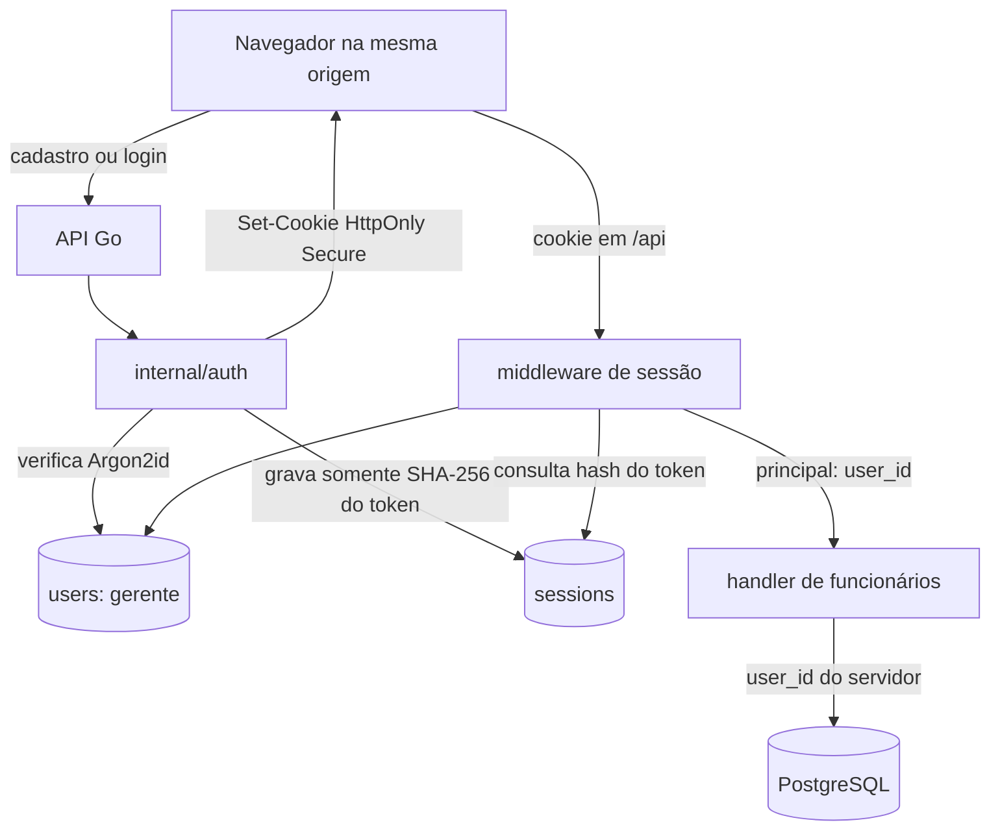

# Plano de implementação

## Arquitetura proposta

Um monorepo com `apps/web` (React + TypeScript) e `apps/api` (Go). A interface consome `/api` no mesmo domínio. Banco relacional para lançamentos, estoque e histórico; escolher o provedor ao iniciar a implementação. O deploy desejado é um único projeto Vercel com frontend e API publicados juntos por Vercel Services, que está em beta. Validar um protótipo mínimo de build e roteamento do serviço Go antes de implementar as regras de negócio. [Fonte: Vercel Services](https://vercel.com/docs/services) e [runtime Go](https://vercel.com/docs/functions/runtimes/go).

```text
agrofin/
  apps/
    api/
      go.mod
      cmd/api/                 # entrada local
      cmd/migrate/             # aplicar e consultar migrações
      internal/
        colheita/
        funcionarios/          # cadastro simples e rotas da feature
        pagamentos/
        vendas/
        despesas/
        insumos/
        pulverizacoes/
        relatorios/
        platform/             # banco, autenticação, criptografia
      migrations/
    web/
      src/
        app/                  # rotas e composição
        features/
          user/
          limao/
          funcionarios/
          pagamentos/
          vendas/
          despesas/
          insumos/
          pulverizacoes/
          calendario/
          relatorios/
        shared/               # componentes e utilidades comuns
  docs/
  vercel.json                 # configuração após validar o protótipo
```

No Go, manter `cmd` para a entrada executável e `internal` para os pacotes do projeto. As rotas de uma funcionalidade pertencem ao pacote dessa funcionalidade, como `internal/funcionarios`; `cmd/api` compõe as rotas e inicia o servidor. `platform` recebe infraestrutura transversal apenas quando ela surgir. Os pacotes devem refletir responsabilidades reais, sem impor camadas vazias. Uma adaptação de entrada para a Vercel pode chamar a mesma aplicação HTTP usada localmente. No React, organizar por `features/<domínio>`, seguindo o padrão informado pelo usuário; código compartilhado fica em `shared` quando for realmente reutilizado.

A base React em `apps/web` já está implementada com Vite, Tailwind e shadcn; o serviço `web` no Compose oferece HMR e proxy `/api` para o Go. Veja a [estrutura e convenções](../apps/web/README.md). As demais features da árvore são propostas e serão criadas quando tiverem código real.

O PostgreSQL local, as migrações, a conexão inicial da API e as camadas de cadastro de funcionários estão implementados; o POST ainda depende da integração com o login para ficar disponível. A autenticação, os demais fluxos de escrita, a criptografia na aplicação e o protótipo de deploy unificado ainda pertencem às próximas etapas.

### Organização interna do cadastro de funcionários

O caminho de criação HTTP está implementado em `internal/funcionarios`, com todos os arquivos no mesmo pacote:

| arquivo | responsabilidade implementada |
| --- | --- |
| `employee.go` | Define `Employee` e normaliza o nome, removendo espaços das extremidades e rejeitando resultado vazio. Preserva acentos, grafia e espaços internos. |
| `service.go` | `Service.Create` valida o nome e monta a entidade `Employee` com o ID do gerente e estado ativo inicial antes de chamar a persistência. |
| `repository.go` | `Repository.Create` recebe um `Employee` validado, executa o `INSERT` parametrizado e devolve a entidade com o ID gerado pelo banco. |
| `handler.go` | Compõe o fluxo HTTP: verifica a disponibilidade, chama o serviço com o contexto da requisição e delega a entrada e a resposta às funções auxiliares. |
| `handler_request.go` | Define o DTO de entrada e valida o tipo de mídia, o tamanho e o formato do JSON. A validação aqui é do protocolo; regras do cadastro ficam no serviço. |
| `handler_response.go` | Define os DTOs de saída, converte erros da aplicação em status HTTP e serializa as respostas JSON. |
| `routes.go` | Registra o POST de cadastro e mantém o GET provisório que retorna uma lista vazia. |

Os arquivos permanecem no pacote `funcionarios`: a separação por arquivo organiza responsabilidades sem criar camadas ou pacotes artificiais. Como convenção para a API Go, mantenha em `handler.go` a coordenação do fluxo; coloque decodificação e validação do protocolo de entrada em `handler_request.go`; e deixe DTOs, serialização e tradução para respostas HTTP em `handler_response.go`. Essas funções continuam privadas ao pacote, e uma função auxiliar sem necessidade do estado de `Handler` deve ser uma função de pacote, não um método com receiver artificial. O service não deve depender de tipos ou status HTTP. Crie esses arquivos quando houver conteúdo real para a responsabilidade, sem arquivos vazios nem um pacote genérico `helpers`.

A composição no `cmd/api/main.go` é:

```go
repo := funcionarios.NewRepository(pool)
service := funcionarios.NewService(repo)
// O handler lê o principal do contexto; o middleware ainda será integrado.
handler := funcionarios.NewHandler(service)
funcionarios.RegisterRoutes(mux, handler)
```

O pool é aberto e fechado pela aplicação; o repositório apenas o utiliza. A interface privada `employeeCreator`, declarada junto do serviço que a consome, permite testar a validação sem PostgreSQL. Ela descreve a única operação necessária, sem criar um repositório genérico ou interfaces antecipadas para outros domínios. Cada funcionalidade pode ter seu próprio repositório usando o mesmo pool.

O serviço recebe o ID do gerente e o nome, normaliza e valida o nome e monta `Employee{UserID: userID, Name: name, Active: true}`. Em seguida chama `repo.Create(ctx, employee)`. O repositório recebe a struct de domínio por valor, persiste gerente, nome e estado e devolve a entidade com ID gerado pelo banco. Receber por valor evita alterar a struct do chamador implicitamente; o resultado persistido é explícito no retorno. O ID fica vazio somente antes da inserção. `UserID` é um vínculo técnico do domínio, não um campo do formulário HTTP. Nomes iguais continuam permitidos. O repositório não repete a normalização nem escolhe o estado inicial; as restrições SQL continuam protegendo a integridade. Como os campos de `Employee` são exportados, a struct sozinha não comprova validação: o serviço é a entrada das operações de cadastro. A inserção atual é uma única instrução atômica, sem necessidade de transação explícita.

`ctx context.Context` vem de `r.Context()` no handler e é passado como primeiro argumento do serviço até `QueryRow`, propagando cancelamento e prazo. Não é guardado nas structs nem substituído por um novo `context.Background()`. O nome e o `userID` continuam sendo argumentos explícitos; contexto não substitui os dados do cadastro. O contexto de inicialização do `main` serve apenas para abrir o banco, sem ser reaproveitado nas requisições.

O POST aceita um único objeto JSON com `name`. Campos desconhecidos, inclusive `user_id`, são rejeitados. O corpo é limitado a 4 KiB. As respostas são JSON: `201` com `id`, `name` e `active`; `400` para JSON ou nome inválido; `413` para corpo excessivo; `415` para tipo diferente de `application/json`; `500` para falha interna sem detalhes do driver; `408` para cancelamento e `504` para prazo esgotado. Os erros usam `{"error":"mensagem em português"}`. Nomes iguais criam funcionários distintos; não há deduplicação por nome nem idempotência do cadastro nesta etapa.

O `main` monta o handler sem um gerente autenticado, e o POST responde `503` antes de chamar o serviço. O login deverá fornecer o `user_id` do gerente autenticado por requisição. Esse identificador nunca é aceito no corpo ou cabeçalho do cadastro. Os testes fornecem um ID diretamente para verificar o fluxo independentemente da futura autenticação.

**Ainda pendente:** middleware de autenticação que popula o principal da requisição, listagem persistida, renomeação e desativação. O tipo `auth.Principal` já reserva `user_id` no contexto; as regras permanecem no serviço e o SQL no repositório.

Os testes de serviço verificam normalização, bloqueio de nome vazio antes da persistência, propagação de contexto e `user_id` e preservação de erros. Os testes de handler verificam o contrato HTTP e os caminhos de erro sem banco. Para executar também o teste de integração, use um banco exclusivo de teste com as migrações aplicadas e forneça `TEST_DATABASE_URL` ao executar `go test ./...` em `apps/api`. Esse teste envia requisições HTTP reais para um servidor temporário e verifica gravação, vínculo com o gerente, IDs distintos para nomes iguais, estado ativo inicial, nome inválido sem gravação e cancelamento. Sem essa variável, a integração é explicitamente pulada; os demais testes continuam executando. A fixture cria seu gerente de teste e remove somente os registros criados por ele ao terminar.

### identidade e autenticação propostas

O modelo usa `users` para o gerente que autentica e `employees` para as pessoas que trabalham na produção, sem credenciais. Cada tabela de negócio guarda `user_id`; não existe tabela `accounts`. As migrações limitam esta instalação a um único gerente. O cadastro inicial está em `POST /api/v1/auth/register`, recebe `login_name` e `password`, exige `X-Agrofin-Setup-Token` configurado por `AUTH_SETUP_TOKEN` e só funciona antes de existir usuário.

O hash de senha Argon2id, a rota `register` e o tipo de principal no contexto estão implementados. Login, sessão, cookie, CSRF e middleware continuam pendentes. Quando houver sessão, o middleware resolverá o `user_id` no servidor e os handlers passarão esse valor aos serviços. O cliente nunca envia o `user_id` de proprietário dos dados.



#### senha

Senha não é dado para cifrar e recuperar: armazenar somente um hash adaptativo Argon2id com salt aleatório, parâmetros e versão codificados no formato PHC. O cadastro atual usa `m=19456 KiB, t=2, p=1`, sujeito a medição no runtime publicado. A entrada é normalizada em Unicode NFC e aceita de 15 a 128 caracteres. Uma lista local bloqueia algumas senhas conhecidamente fracas; uma lista ampla e atualizável de senhas comprometidas ainda precisa ser definida. Nunca registrar senha ou hash em logs. A cifra autenticada dos valores financeiros continua sendo uma proteção separada. [OWASP Password Storage](https://cheatsheetseries.owasp.org/cheatsheets/Password_Storage_Cheat_Sheet.html) e [NIST SP 800-63B](https://pages.nist.gov/800-63-4/sp800-63b.html).

No login, limitar tentativas em mecanismo compartilhado entre instâncias e limitar a concorrência de verificações Argon2id, pois o algoritmo consome memória e CPU deliberadamente. Ao verificar o hash, aceitar somente algoritmos e custos dentro de limites configurados para impedir que um valor alterado no banco force consumo arbitrário de recursos.

#### sessão, cookie e origem

- Preferir sessão opaca mantida no PostgreSQL: gerar token aleatório de 32 bytes com `crypto/rand`, enviar no cookie e guardar somente SHA-256 do token, com usuário, criação, última atividade, expiração e revogação.
- Em produção, emitir `__Host-agrofin_session; Secure; HttpOnly; SameSite=Lax; Path=/`, sem `Domain`, sempre por HTTPS. Renovar a sessão após login, revogar no banco no logout e expirar o cookie na resposta. Não guardar token em `localStorage` nem `sessionStorage`.
- Manter interface e API na mesma origem, com `/api` encaminhado ao Go. Validar `Origin` contra a origem pública configurada em todas as operações que alteram estado e rejeitar `Sec-Fetch-Site: cross-site` quando presente. A API não habilita CORS com credenciais; nenhum `GET` altera dados. `SameSite=Lax` é defesa em profundidade, não substitui a validação de origem.

#### rotas e ordem de implementação

```text
POST /api/v1/auth/register  # cadastro único do gerente; requer token de cadastro
POST /api/v1/auth/login     # credenciais; cria sessão e cookie
POST /api/v1/auth/logout    # revoga sessão e limpa cookie
GET  /api/v1/auth/me        # informa se há sessão válida e dados públicos mínimos
```

Próximo: implementar login e sessões; depois middleware e proteção de origem; então ligar o `user_id` autenticado às rotas de funcionários e remover o `503` provisório. Proteger também a listagem vazia atual para que nenhuma rota de negócio permaneça pública por acidente. Login deve devolver erro genérico para usuário inexistente e senha inválida, aplicar limitação de tentativas e usar `Cache-Control: no-store`.

Antes de produção, validar: sessão expirada ou revogada falha; logout invalida o token no servidor; `user_id` forjado é ignorado/rejeitado; cada rota privada obtém o gerente pela sessão; origens cruzadas não alteram dados; atributos do cookie aparecem corretamente sob HTTPS; e o banco não contém senha em texto claro nem token de sessão reutilizável.

## Sequência sugerida

| etapa | entrega verificável |
| --- | --- |
| 1. base técnica | React e Go sob a mesma origem, PostgreSQL e cadastro/Argon2id estão disponíveis; próximo implementar login, sessão, cookie, proteção CSRF e middleware que popula o principal por requisição para liberar o cadastro autenticado de funcionários. |
| 2. primeiro fluxo completo | Cadastrar funcionário e tarifa, registrar caixas, ver resumo semanal e registrar pagamento. Validar os exemplos de cálculo dos [critérios de aceite](criterios-de-aceite.md). |
| 3. vendas e despesas | Registrar venda por classificação, desconto e recebimento; registrar energia e demais despesas; mostrar painel com vendido, recebido, devido, pago e saldo de caixa separados. |
| 4. insumos e calendário | Registrar produto, compra, estoque e pulverização; permitir cadastro rápido; mostrar calendário e mudança das fases da Lua. |
| 5. uso real | Observar o registro de uma semana com o cliente, corrigir rótulos e passos difíceis e conferir resultados com os controles que ele já usa. |

O primeiro fluxo completo é o **MVP de validação**: já resolve a rotina de maior frequência e permite descobrir cedo se o lançamento por funcionário e o fechamento semanal estão simples o bastante.

## Contrato inicial da api

Manter rotas versionadas sob `/api/v1` e respostas JSON. Uma proposta mínima para o primeiro fluxo é:

```text
GET/POST       /api/v1/employees
PATCH          /api/v1/employees/{id}       # renomear
DELETE         /api/v1/employees/{id}       # desativar, sem apagar histórico
GET/POST       /api/v1/harvest-rates
GET/POST       /api/v1/harvest-entries
PATCH          /api/v1/harvest-entries/{id}
GET            /api/v1/payroll-weeks/{week}/summary
POST           /api/v1/employee-payments
```

O servidor calcula totais e saldos; o frontend apresenta o resultado e não é a fonte de verdade dos valores. As operações de escrita precisam de validação, autorização, transação e proteção contra envio duplicado. Detalhar os demais endpoints quando as primeiras telas e regras estiverem validadas.

## Verificações que importam

- Testes de domínio para tarifa por vigência, caixas normais e de moagem, diárias, pagamento parcial e saldo semanal.
- Testes de integração para uma correção após pagamento, venda com desconto, recebimento parcial e compra que afeta despesa e estoque uma só vez.
- Teste de segurança que inspeciona um banco de teste e confirma que valores monetários persistidos não aparecem em texto claro, além de teste de restauração com as chaves corretas.
- Teste no celular de uma sequência real: registrar caixas para vários funcionários, fechar a semana e registrar uma pulverização com insumo novo.

## Decisões técnicas antes do código de produção

- Definir modelo de criptografia por campo, serviço de chaves separado do banco e recuperação/rotação. Indicadores financeiros devem ser calculados no servidor a partir de dados autorizados; não persistir agregados sensíveis em texto aberto. [Referência: OWASP](https://cheatsheetseries.owasp.org/cheatsheets/Cryptographic_Storage_Cheat_Sheet.html).
- Validar o caminho de deploy de React estático e API Go em um projeto Vercel Services; a configuração final depende do protótipo e da documentação vigente, pois o recurso está em beta.
- Definir o calendário semanal, as unidades de estoque e a origem dos dados lunares com o cliente antes de fechar essas regras.
