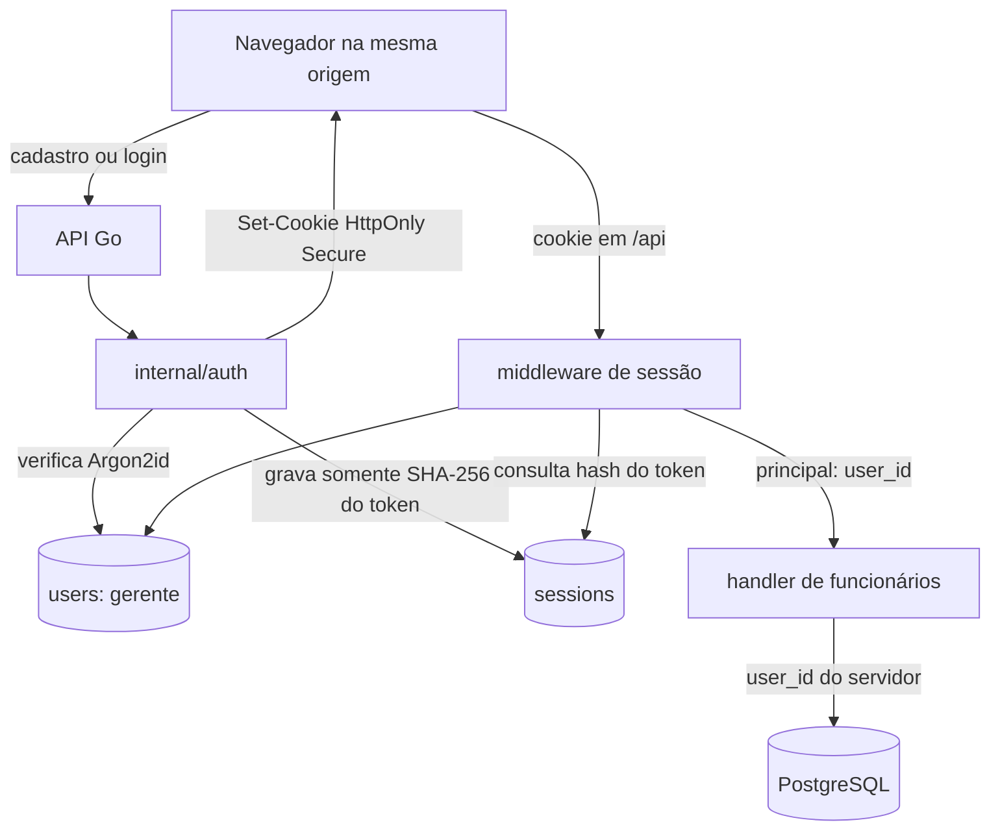

# Plano de implementação

## Arquitetura proposta

Um monorepo com `apps/web` (React + TypeScript) e `apps/api` (Go). A interface consome `/api` no mesmo domínio. Banco relacional para lançamentos, estoque e histórico; escolher o provedor ao iniciar a implementação. O deploy desejado é um único projeto Vercel com frontend e API publicados juntos por Vercel Services, que está em beta. Validar um protótipo mínimo de build e roteamento do serviço Go antes de implementar as regras de negócio. [Fonte: Vercel Services](https://vercel.com/docs/services) e [runtime Go](https://vercel.com/docs/functions/runtimes/go).

```text
agrofin/
  apps/
    api/
      go.mod
      cmd/api/                 # entrada local
      cmd/migrate/             # aplicar e consultar migrações
      internal/
        colheitas/             # proposta: lançamentos e seus itens
        funcionarios/          # cadastro simples e rotas da feature
        pagamentos/
        vendas/
        despesas/
        insumos/
        pulverizacoes/
        relatorios/
        platform/             # banco, autenticação, criptografia
      migrations/
    web/
      src/
        app/                  # rotas e composição
        features/
          user/
          limao/
          funcionarios/
          pagamentos/
          vendas/
          despesas/
          insumos/
          pulverizacoes/
          calendario/
          relatorios/
        shared/               # componentes e utilidades comuns
  docs/
  vercel.json                 # configuração após validar o protótipo
```

No Go, manter `cmd` para a entrada executável e `internal` para os pacotes do projeto. As rotas de uma funcionalidade pertencem ao pacote dessa funcionalidade, como `internal/funcionarios`; `cmd/api` compõe as rotas e inicia o servidor. `platform` recebe infraestrutura transversal apenas quando ela surgir. Os pacotes devem refletir responsabilidades reais, sem impor camadas vazias. Uma adaptação de entrada para a Vercel pode chamar a mesma aplicação HTTP usada localmente. No React, organizar por `features/<domínio>`, seguindo o padrão informado pelo usuário; código compartilhado fica em `shared` quando for realmente reutilizado.

A base React em `apps/web` usa Vite, Tailwind e shadcn; o serviço `web` no Compose oferece HMR e proxy `/api` para o Go. Há uma landing page e páginas demonstrativas para os domínios de produção, financeiro, manejo e relatórios. Formulários e totais são mockados no navegador e não representam fluxos de negócio integrados nem dados persistidos; a [estrutura e convenções](../apps/web/README.md) descreve essa demonstração. As regras de negócio, a integração com a API e os demais recursos permanecem sujeitos à implementação e validação com o cliente.

O PostgreSQL local, as migrações, a conexão inicial da API, o cadastro, a listagem, a renomeação, a desativação e a reativação de funcionários e a autenticação do gerente estão implementados. O cadastro de funcionário já exige sessão. O serviço de tarifas e o componente local de cifra estão implementados, mas a composição das chaves no runtime e sua integração HTTP, os demais fluxos de escrita e o protótipo de deploy unificado ainda pertencem às próximas etapas.

### Organização interna do cadastro de funcionários

Os caminhos HTTP de criação, listagem, renomeação, desativação e reativação estão implementados em `internal/funcionarios`, com todos os arquivos no mesmo pacote:

| arquivo | responsabilidade implementada |
| --- | --- |
| `entity.go` | Define `Employee` e normaliza o nome, removendo espaços das extremidades e rejeitando resultado vazio. Preserva acentos, grafia e espaços internos. |
| `service.go` | `Service.Create` valida o nome e monta a entidade `Employee` com o ID do gerente e estado ativo inicial antes de chamar a persistência. `Service.List` delega a consulta com o ID do gerente, o filtro opcional de estado e o contexto recebidos. `Service.Rename` reutiliza a normalização do nome e monta a entidade antes da atualização. `Service.Deactivate` monta a entidade com identificação e estado inativo; `Service.Reactivate` faz o mesmo com estado ativo. |
| `repository.go` | `Repository.Create` recebe um `Employee` validado, executa o `INSERT` parametrizado e devolve a entidade com o ID gerado pelo banco. `Repository.List` filtra por gerente, aplica o estado quando informado e ordena por nome e ID. `Repository.Rename` atualiza somente o nome, filtrando por ID e gerente, e traduz ausência para `ErrNotFound`. `Repository.Deactivate` atualiza o estado e a data sem excluir o registro; repetição preserva a primeira data e ausência também vira `ErrNotFound`. `Repository.Reactivate` restaura o estado e limpa o marcador de desativação sob o mesmo dono. |
| `handler.go` | Compõe o fluxo HTTP: obtém o principal autenticado, chama o serviço com o contexto da requisição e delega a entrada e a resposta às funções auxiliares. |
| `handler_request.go` | Decodifica o filtro opcional de estado e compartilha o DTO e o decodificador de nome entre cadastro e renomeação; valida tipo de mídia, tamanho e formato do JSON e UUID do caminho; rejeita corpo nas operações de desativação e reativação. Regras do nome ficam no serviço. |
| `errors.go` | Define os erros de domínio `ErrInvalidName` e `ErrNotFound`, sem dependência de HTTP ou do driver. |
| `handler_response.go` | Define os DTOs de saída, converte erros da aplicação em status HTTP e serializa as respostas JSON. |
| `routes.go` | Registra criação, listagem, renomeação, desativação e reativação, todas protegidas pelo middleware de sessão. |

Os arquivos permanecem no pacote `funcionarios`: a separação por arquivo organiza responsabilidades sem criar camadas ou pacotes artificiais. Como convenção para a API Go, mantenha em `handler.go` a coordenação do fluxo; coloque decodificação e validação do protocolo de entrada em `handler_request.go`; e deixe DTOs, serialização e tradução para respostas HTTP em `handler_response.go`. Essas funções continuam privadas ao pacote, e uma função auxiliar sem necessidade do estado de `Handler` deve ser uma função de pacote, não um método com receiver artificial. O service não deve depender de tipos ou status HTTP. Crie esses arquivos quando houver conteúdo real para a responsabilidade, sem arquivos vazios nem um pacote genérico `helpers`.

A composição no `cmd/api/main.go` é:

```go
repo := funcionarios.NewRepository(pool)
service := funcionarios.NewService(repo)
// O middleware confirma a sessão antes de o handler ler o principal.
handler := funcionarios.NewHandler(service)
authService := auth.NewService(auth.NewRepository(pool))
sessionMiddleware := auth.NewMiddleware(authService, cookieSecure)
funcionarios.RegisterRoutes(apiMux, handler, sessionMiddleware.RequireSession)
```

O pool é aberto e fechado pela aplicação; o repositório apenas o utiliza. A interface privada `employeeRepository`, declarada junto do serviço que a consome, permite testar a validação sem PostgreSQL. Ela descreve somente as operações `Create`, `List`, `Rename`, `Deactivate` e `Reactivate`, sem criar um repositório genérico ou interfaces antecipadas para outros domínios. Cada funcionalidade pode ter seu próprio repositório usando o mesmo pool.

O serviço recebe o ID do gerente e o nome, normaliza e valida o nome e monta `Employee{UserID: userID, Name: name, Active: true}`. Em seguida chama `repo.Create(ctx, employee)`. O repositório recebe a struct de domínio por valor, persiste gerente, nome e estado e devolve a entidade com ID gerado pelo banco. Receber por valor evita alterar a struct do chamador implicitamente; o resultado persistido é explícito no retorno. O ID fica vazio somente antes da inserção. `UserID` é um vínculo técnico do domínio, não um campo do formulário HTTP. Nomes iguais continuam permitidos. O repositório não repete a normalização nem escolhe o estado inicial; as restrições SQL continuam protegendo a integridade. Como os campos de `Employee` são exportados, a struct sozinha não comprova validação: o serviço é a entrada das operações de cadastro. A inserção atual é uma única instrução atômica, sem necessidade de transação explícita.

`ctx context.Context` vem de `r.Context()` no handler e é passado como primeiro argumento do serviço até `QueryRow` ou `Query`, propagando cancelamento e prazo. Não é guardado nas structs nem substituído por um novo `context.Background()`. O nome e o `userID` continuam sendo argumentos explícitos; contexto não substitui os dados do cadastro. O contexto de inicialização do `main` serve apenas para abrir o banco, sem ser reaproveitado nas requisições.

O POST aceita um único objeto JSON com `name`. Campos desconhecidos, inclusive `user_id`, são rejeitados. O corpo é limitado a 4 KiB. As respostas são JSON: `201` com `id`, `name` e `active`; `400` para JSON ou nome inválido; `413` para corpo excessivo; `415` para tipo diferente de `application/json`; `500` para falha interna sem detalhes do driver; `408` para cancelamento e `504` para prazo esgotado. Os erros usam `{"error":"mensagem em português"}`. Nomes iguais criam funcionários distintos; não há deduplicação por nome nem idempotência do cadastro nesta etapa.

O GET retorna `200` com uma lista de objetos `id`, `name` e `active`, incluindo ativos e inativos. A consulta filtra pelo gerente da sessão e ordena por nome e ID, preservando pessoas com nomes iguais. Sem registros, retorna `[]`, nunca `null`. O filtro opcional `active` aceita uma única ocorrência com `true` ou `false` em minúsculas; ausente retorna ambos os estados. Valores vazios, diferentes, repetidos ou query malformada retornam `400`. Não há paginação nesta etapa; a integração da seleção de ativos no formulário de novos lançamentos pertence ao futuro fluxo de colheita. Falhas retornam `500` sem detalhes internos, cancelamento retorna `408` e prazo esgotado retorna `504`.

O PATCH `/employees/{id}` exige sessão e um UUID de 36 caracteres no caminho, com hífens nas posições padrão e dígitos hexadecimais; aceita letras maiúsculas ou minúsculas, sem impor versão de UUID. Essa validação pertence ao protocolo e ocorre antes de chamar o serviço. O corpo aceita somente `name` e compartilha o decodificador do cadastro, com limite de 4 KiB e rejeição de campos extras. O serviço remove espaços das extremidades e rejeita nome vazio. O SQL usa `WHERE id = $2 AND user_id = $3` e altera apenas `name`, preservando dono, estado e data de desativação. A única instrução `UPDATE ... RETURNING` é atômica e dispensa consulta prévia ou transação explícita. Retorna `200` com `id`, `name` e `active`; `400` para entrada inválida; `401` sem sessão; `404` tanto para ID inexistente quanto para funcionário de outra conta, sem revelar sua existência; `413` para corpo excessivo; `415` para tipo de mídia incorreto; `408`, `504` e `500` para cancelamento, prazo esgotado e falha interna. Repetir o nome ou usar um nome já existente é permitido. A coleção de requisições em formato Postman v2.1 inclui a operação e a variável `employee_id`; pode ser usada no Postman ou importada no Bruno.

O DELETE `/employees/{id}` desativa o funcionário sem apagar o cadastro nem seus vínculos históricos. Exige sessão, UUID no caminho, `Origin` e `X-Agrofin-Request: 1`, sem corpo ou exigência de `Content-Type`. Qualquer corpo é rejeitado com `400`; a leitura limitada a um byte também cobre tamanho desconhecido sem carregar o conteúdo inteiro. O serviço monta `Employee{ID: employeeID, UserID: userID, Active: false}`. O repositório recebe essa entidade e executa um único `UPDATE` filtrado por ID e gerente, alterando somente `active` e `deactivated_at`. `COALESCE(deactivated_at, now())` registra a primeira data e a preserva em repetições, inclusive concorrentes. Não há filtro por estado no WHERE: um registro já inativo também retorna sucesso; zero linhas afetadas vira `ErrNotFound`. Não é necessária migração nem transação explícita. Retorna `204` sem corpo, inclusive na repetição; `400` para UUID ou corpo inválido; `401` sem sessão; `403` quando origem ou marcador de escrita forem inválidos; `404` tanto para registro inexistente quanto de outra conta; `408`, `504` e `500` para cancelamento, prazo esgotado e falha interna. O funcionário continua na listagem com `active=false`. A coleção Postman v2.1 inclui a requisição sem corpo, usando a variável `employee_id`; ela pode ser usada no Postman ou importada no Bruno.

O PATCH `/employees/{id}/reactivate` restaura `active=true` e limpa `deactivated_at` no mesmo `UPDATE`, filtrado por ID e gerente. A restrição do banco exige essa combinação para um registro ativo. Não cria outro cadastro nem altera nome, dono, data de criação ou vínculos históricos. Exige sessão, UUID válido, origem, marcador de escrita e ausência de corpo, compartilhando o decodificador com a desativação. Retorna `204` vazio inclusive para registro já ativo; `400`, `401`, `403`, `404`, `408`, `504` e `500` seguem os mesmos significados da desativação. Não exige migração ou transação explícita. Desativar novamente registra a data de um novo ciclo; repetir a desativação nesse ciclo preserva essa nova data. A limpeza do marcador atual não altera os lançamentos históricos e não representa reativação de uma conta de gerente.

O middleware de sessão valida o cookie e anexa o `user_id` confirmado ao contexto por requisição. As rotas `GET /employees`, `POST /employees`, `PATCH /employees/{id}`, `DELETE /employees/{id}` e `PATCH /employees/{id}/reactivate` exigem sessão; o handler também responde `401` se for usado sem o middleware. Esse identificador nunca é aceito no corpo ou cabeçalho do cadastro. Os testes de handler fornecem um principal controlado e os testes de integração passam pelo fluxo HTTP com o vínculo do gerente.

**Cadastro de funcionários entregue na API:** criação, listagem, renomeação, desativação e reativação. O filtro opcional de estado também está implementado. A integração com o frontend e os fluxos de lançamento continuam pendentes. O tipo `auth.Principal` transporta a identidade validada pelo middleware; as regras permanecem no serviço e o SQL no repositório.

Os testes de serviço verificam normalização, bloqueio de nome vazio antes da persistência, propagação de contexto e `user_id` e preservação de erros. Os testes de handler verificam o contrato HTTP e os caminhos de erro sem banco. Para executar também o teste de integração, use um banco exclusivo de teste com as migrações aplicadas e forneça `TEST_DATABASE_URL` ao executar `go test ./...` em `apps/api`. Esse teste envia requisições HTTP reais para um servidor temporário e verifica gravação, vínculo com o gerente, IDs distintos para nomes iguais, estado ativo inicial, nome inválido sem gravação, listagem vazia, ordenação com nomes iguais, retorno de inativos, filtro por gerente, renomeação persistida, nomes repetidos, preservação de estado e data de desativação, rejeição de alterações entre contas, desativação persistida e repetida com data estável, preservação de histórico vinculado, reativação repetida com limpeza do marcador, novo ciclo de desativação, filtro de ativos/inativos com isolamento entre contas, retorno vazio e atualização após mudança de estado, proteção de origem e cancelamento. Sem essa variável, a integração é explicitamente pulada; os demais testes continuam executando. A fixture cria seu gerente de teste e remove somente os registros criados por ele ao terminar.

### identidade e autenticação implementadas

O modelo usa `users` para o gerente que autentica e `employees` para as pessoas que trabalham na produção, sem credenciais. Cada tabela de negócio guarda `user_id`; não existe tabela `accounts`. A migração `00009_public_registration.sql` permite várias contas independentes, preservando os dados existentes. O cadastro público está em `POST /api/v1/auth/register`, recebe `name`, `login_name` e `password` e não exige token de instalação. Cada cliente é gerente dos próprios dados; somente o nome de acesso precisa ser único, inclusive sob concorrência.

O cadastro público, login, logout, consulta da sessão, perfil, alteração de nome e senha, desativação, cookie e middleware estão implementados. O cadastro recebe `name`, `login_name` e `password`; o nome é exibido no perfil e `login_name` permanece imutável pela API. `GET /auth/me` retorna o perfil autenticado. `PATCH /auth/me` atualiza somente `name`. `PATCH /auth/me/password` recebe `current_password` e `new_password`; após validar a senha atual, salva um novo hash e revoga as sessões para exigir login novamente. `confirm_password` é comparação local do formulário, não dado enviado à API. `PATCH /auth/me/status` aceita desativação, encerra as sessões na mesma transação e limpa o cookie. Uma conta desativada não autentica. A reativação ainda exige intervenção de operador, pois não há fluxo público para isso; sessões antigas são revogadas e não voltam a funcionar. O middleware resolve o token opaco no PostgreSQL e anexa o `user_id` ao contexto; o cliente nunca escolhe esse vínculo. A sessão expira após sete dias sem atividade ou trinta dias desde o login. Cada login ganha um token novo de 32 bytes aleatórios; somente SHA-256 é persistido. Credenciais inexistentes, senha incorreta e usuário inativo recebem a mesma resposta. Verificações Argon2id são limitadas a duas simultâneas por processo; limitar tentativas por IP fica para a borda antes da publicação.



#### senha

Senha não é dado para cifrar e recuperar: armazenar somente um hash adaptativo Argon2id com salt aleatório, parâmetros e versão codificados no formato PHC. O cadastro atual usa `m=19456 KiB, t=2, p=1`, sujeito a medição no runtime publicado. A entrada é normalizada em Unicode NFC e aceita de 15 a 128 caracteres. Uma lista local bloqueia algumas senhas conhecidamente fracas; uma lista ampla e atualizável de senhas comprometidas ainda precisa ser definida. Nunca registrar senha ou hash em logs. A cifra autenticada dos valores financeiros continua sendo uma proteção separada. [OWASP Password Storage](https://cheatsheetseries.owasp.org/cheatsheets/Password_Storage_Cheat_Sheet.html) e [NIST SP 800-63B](https://pages.nist.gov/800-63-4/sp800-63b.html).

Ao verificar o hash, aceitar somente Argon2id e parâmetros dentro de limites rígidos para impedir que um hash alterado no banco force consumo arbitrário de recursos. O processo limita a duas verificações Argon2id concorrentes para conter consumo de memória. Ainda não há limite de frequência de logins; antes da publicação, configurar rate limiting na borda confiável, que conhece o IP real e evita uma tabela de contadores no banco da aplicação.

#### sessão, cookie e origem

- A tabela `sessions` guarda usuário, hash do token, criação, última atividade, expiração absoluta e revogação. Cada requisição autenticada atualiza `last_seen_at`; sessões revogadas ou vencidas não resolvem um principal.
- Em produção, emitir `__Host-agrofin_session; Secure; HttpOnly; SameSite=Lax; Path=/`, sem `Domain`, sempre por HTTPS. No HTTP local, usar `agrofin_session` sem `Secure` para permitir o navegador de desenvolvimento. A configuração exige que `SESSION_COOKIE_SECURE` corresponda ao esquema de `PUBLIC_ORIGIN`. Logout revoga no banco e expira o cookie. Tokens não ficam em `localStorage` nem `sessionStorage`.
- Manter interface e API na mesma origem. Todas as operações diferentes de `GET`, `HEAD` e `OPTIONS` validam `Origin`, rejeitam `Sec-Fetch-Site` diferente de `same-origin` quando presente e exigem o cabeçalho `X-Agrofin-Request: 1`. A API não habilita CORS com credenciais. `SameSite=Lax` é defesa em profundidade, não substitui essa validação.

#### rotas e ordem de implementação

```text
POST ${API_PREFIX}/auth/register  # cadastro público de uma conta de cliente/gerente
POST ${API_PREFIX}/auth/login     # credenciais; cria sessão e cookie
POST ${API_PREFIX}/auth/logout    # revoga sessão e limpa cookie
GET  ${API_PREFIX}/auth/me        # retorna o perfil autenticado
PATCH ${API_PREFIX}/auth/me       # altera somente o nome de exibição
PATCH ${API_PREFIX}/auth/me/password # valida a senha atual, troca a senha e revoga as sessões
PATCH ${API_PREFIX}/auth/me/status # desativa a conta e revoga sessões; reativação por operador
```

Todas as rotas de negócio existentes exigem sessão. Rotas de autenticação devolvem `Cache-Control: no-store`; o cadastro público, login e logout também passam pela proteção de origem. Ainda não há interface web para login; clientes HTTP devem enviar o cabeçalho `X-Agrofin-Request: 1` e a origem configurada.

Antes de produção, validar: sessão expirada ou revogada falha; logout invalida o token no servidor; `user_id` forjado é ignorado/rejeitado; cada rota privada obtém o gerente pela sessão; origens cruzadas não alteram dados; atributos do cookie aparecem corretamente sob HTTPS; e o banco não contém senha em texto claro nem token de sessão reutilizável.

## Funcionários, colheitas e agregados

As caixas colhidas ficam vinculadas ao funcionário, mas cada lançamento de colheita forma um agregado próprio. Essa é uma escolha do domínio que pode ser aplicada tanto em Java quanto em Go. O retorno de `/employees` contém somente o cadastro; criação e consulta de lançamentos têm rotas próprias. Para o significado dos termos usados nos identificadores, consulte a [linguagem de domínio](linguagem-de-dominio.md).

### Relacionamento e agregado

Um funcionário pode ter várias colheitas ao longo do tempo. Esse relacionamento não exige que todo o histórico faça parte de uma única unidade de gravação. Um agregado reúne objetos que precisam ser tratados como uma unidade de consistência, com uma raiz responsável pela integridade do conjunto. [Referência: Martin Fowler](https://martinfowler.com/bliki/DDD_Aggregate.html).

| Unidade | Responsabilidade |
| --- | --- |
| Funcionário | Nome, identificação, dono e estado ativo/inativo. |
| Colheita | Funcionário, data e itens daquele lançamento. É a raiz do agregado de colheita. |
| Item da colheita | Tipo de caixa, quantidade e tarifa aplicada no lançamento. Pertence à colheita. |

Para registrar uma colheita, cabeçalho e itens precisam ser gravados juntos em uma transação. Para renomear um funcionário, basta alterar seu cadastro; não é necessário carregar todas as colheitas ou pagamentos dele. Diárias e pagamentos também têm operações e ciclos de vida próprios e não precisam ser coleções carregadas dentro de `Employee`.

### Organização proposta em Go

```text
internal/
  funcionarios/              # Implementado: cadastro e rotas do funcionário
    entity.go
    service.go
    repository.go
    ...
  colheitas/                 # Implementados: tarifas, criação e consulta de colheitas
    rate.go
    rate_cipher.go
    service.go
    repository.go
    handler.go
    handler_request.go
    handler_response.go
    routes.go
    errors.go
    harvest.go                 # Agregado e itens de lançamento
    harvest_service.go         # Tarifa vigente e gravação do agregado
    ...
```

`colheitas` é um pacote irmão de `funcionarios`, iniciado pelo núcleo local de tarifas, com serviço e repositório próprios já implementados. Colocar uma pasta em `funcionarios/colheitas` não criaria uma relação especial entre os tipos nem daria acesso aos identificadores privados do pacote acima. Em Go, os arquivos de um mesmo diretório formam um pacote; diretórios distintos são pacotes distintos. [Documentação de Go](https://go.dev/doc/code#Code_organization).

O exemplo abaixo mostra somente a relação por ID e a composição dos itens; não é a entidade completa nem código já implementado:

```go
// Os itens pertencem ao lançamento e são persistidos junto com ele.
type Harvest struct {
	ID         string
	UserID     string
	EmployeeID string
	Items      []Item
}

type Item struct {
	BoxType  string
	Quantity int
}
```

O primeiro recorte de criação está implementado em `POST /harvest-entries`: o serviço valida data, funcionário, tipos e quantidades, busca a tarifa geral vigente e prepara a fotografia cifrada de cada item. O repositório verifica o estado e o dono do funcionário com bloqueio e grava cabeçalho e itens em uma transação. A consulta por período também está implementada; correção com auditoria e fechamento semanal continuam pendentes. A colheita não cria diária nem pagamento automaticamente.

Se o serviço de colheitas precisar de uma operação do cadastro, a dependência deve ser explícita. Uma interface pequena, declarada junto do consumidor em `colheitas`, pode ser conectada na composição da aplicação. Não criar a interface antes de conhecer a operação necessária nem fazer o cadastro depender de todo o histórico de colheitas.

### Tarifas, criação e consulta inicial de colheitas implementadas

O pacote `internal/colheitas` contém o domínio, serviço, cifra, repositório e as rotas HTTP de tarifas e criação de colheitas. A composição em `cmd/api` carrega as chaves do ambiente e conecta essas dependências.

`BoxType` aceita normal e moagem para pagamento da colheita. É um tipo próprio, mas uma conversão explícita ainda pode criar um valor desconhecido; por isso a validação rejeita o valor vazio e outros tipos, inclusive exportação e mercado, que pertencem à venda.

`Rate` contém identificação, dono, tipo de caixa, `AmountCents int64`, `ValidFrom time.Time` e `ValidUntil *time.Time`. O valor é representado em centavos inteiros, estritamente positivos: `500` representa R$ 5,00. `ValidUntil == nil` significa ausência de fim, enquanto um ponteiro para a data zero é inválido. O início deve ser informado e o fim, quando presente, deve ser posterior ao início. A vigência mantém início inclusivo e fim exclusivo, seguindo o esquema já migrado.

A função privada `normalizeRate` é usada por `Service.CreateRate`, seguindo o padrão de `normalizeName` no cadastro de funcionários. Ela não autentica o dono, consulta outras tarifas ou persiste dados. Os campos exportados de `Rate` não garantem validação por si só; o serviço é a entrada do caso de uso e o handler limita o protocolo HTTP a tipo, centavos e datas.

As datas representam dias, não instantes com horário. A normalização extrai ano, mês e dia no fuso recebido e cria uma representação à meia-noite UTC, sem converter primeiro o instante para UTC e deslocar o dia. A comparação ocorre depois dessa normalização; horários diferentes no mesmo dia não criam uma vigência válida. A função devolve uma cópia da tarifa e uma nova cópia da data final, para uma alteração posterior no ponteiro do chamador não modificar a vigência já validada.

Os testes cobrem os dois tipos, menor valor positivo, valores inválidos, início ausente, fim zero, fim anterior ou igual ao início, horários no mesmo dia e preservação dos dias entre fusos. Também verificam que a entrada e seu ponteiro não são alterados nem compartilhados com o resultado.

`AmountCents` continua somente em memória e na resposta da requisição autorizada: o serviço protege o valor antes de encaminhar a entidade à interface de persistência. A decisão de tarifa geral foi confirmada, e a rota protegida de criação usa essa sequência completa.

### Serviço de tarifas gerais e proteção do valor

A regra confirmada é uma tarifa geral por conta e tipo de caixa, igual para todos os funcionários da conta durante a mesma vigência. Não há exceção individual ou precedência a resolver. A coluna opcional `employee_id` continua no esquema, e o repositório deste fluxo usa `NULL`; isso não habilita cadastro de tarifa individual.

O serviço `CreateRate` já está implementado e testado com dependências controladas. Ele recebe `context.Context`, o gerente do chamador confiável e `CreateRateInput`, que não contém ID, gerente ou funcionário escolhidos pelo cliente. O fluxo é:

```text
Entrada de tarifa geral
  → Validar e normalizar Rate
  → Consultar sobreposição por gerente, tipo e vigência
  → Obter ID gerado pela persistência
  → Cifrar os centavos, autenticando gerente e ID da tarifa
  → Enviar ProtectedRate para gravação
```

As interfaces privadas ficam junto do serviço que as consome. `RatePeriod` delimita a consulta sem transmitir valor financeiro; `ProtectedRate` contém somente metadados e `ProtectedRateAmount`, sem campo de centavos em claro. O retorno `Rate` mantém os centavos em memória para o chamador autorizado. O serviço preserva o contexto em todas as chamadas de persistência e interrompe o fluxo em erros, sobreposição ou cancelamento, sem solicitar uma escrita parcial.

`NextRateID` obtém `gen_random_uuid()` do PostgreSQL antes da cifra e usa esse ID no `INSERT` final, preservando a geração técnica no banco sem inserir uma tarifa incompleta. O ID precisa existir antes da cifra porque é autenticado junto com a conta. A consulta de sobreposição no serviço é complementada pela exclusão existente no PostgreSQL; se uma disputa ocorrer entre consulta e gravação, o repositório traduz a restrição para `ErrRateOverlap`. A integração já testa essa concorrência com o banco real.

`RateCipher`, no próprio pacote `colheitas`, usa AES-256-GCM da biblioteca padrão, com chaves de 32 bytes e nonce aleatório de 96 bits gerado por `cipher.NewGCMWithRandomNonce`. O valor é codificado como oito bytes de centavos inteiros positivos, sem ponto flutuante. O envelope mantém ciphertext com autenticação, nonce separado e versão da chave, conforme as colunas existentes. Para tarifas, o formato do campo, versão, gerente e ID da tarifa formam dados adicionais autenticados. Para a fotografia no item, a autenticação também vincula lançamento, funcionário, data, tipo e quantidade. A composição usa um array JSON para não concatenar identificadores de forma ambígua. [Documentação oficial de Go](https://pkg.go.dev/crypto/cipher#NewGCMWithRandomNonce).

O runtime lê `HARVEST_RATE_ACTIVE_KEY_VERSION` e `HARVEST_RATE_KEYS_HEX_JSON`, um objeto JSON que mapeia versões para chaves hexadecimais de 32 bytes. A inicialização valida a configuração antes de abrir o servidor e falha sem registrar os valores quando faltam chaves, a versão ativa não existe ou o material é inválido. O construtor prepara seu próprio mapa de cifras e aceita versões antigas para recuperação. Para uma rotação manual, configure material novo sob nova versão como ativa e mantenha as antigas necessárias. Repetir material sob duas versões é rejeitado: renomear uma chave não é rotacioná-la. A configuração por ambiente é uma composição inicial; o provedor operacional para produção continua por escolher. Nonces não são chaves e acompanham o envelope.

Antes de habilitar escrita em produção, o provisionamento, rotação e recuperação das chaves e o controle de uso por material devem ser definidos entre todas as instâncias e reinícios. A biblioteca limita AES-GCM com nonce aleatório a no máximo `2^32` cifras por chave; a rotação precisa ocorrer antes desse limite, que não é reiniciado apenas por mudar o nome da versão. Esse controle operacional global não está implementado neste recorte. As chaves devem permanecer fora do banco e de seu backup. [Documentação de Go](https://pkg.go.dev/crypto/cipher#NewGCMWithRandomNonce) e [OWASP Cryptographic Storage](https://cheatsheetseries.owasp.org/cheatsheets/Cryptographic_Storage_Cheat_Sheet.html).

Os testes existentes usam cifras reais para conferir o envelope entregue pelo serviço, recuperação com chave correspondente, leitura de versões anteriores e rejeição de adulteração, chave incorreta e troca de conta ou registro. Dependências controladas verificam que falhas e cancelamentos não avançam para escrita. As rotas de criação e consulta foram conectadas à composição em `cmd/api` e incluídas na coleção Postman v2.1, importável no Bruno. O controle operacional do limite global de uso por chave também continua pendente.

### Persistência PostgreSQL de tarifas gerais

O `Repository` de `internal/colheitas` já implementa as três operações consumidas pelo serviço e utiliza o pool compartilhado da aplicação. Ele não valida entradas, gera cifra ou abre outro pool: recebe o período ou a entidade protegida já preparados pelo serviço.

| Operação | Comportamento implementado |
| --- | --- |
| `HasRateOverlap` | Consulta `EXISTS` por gerente, tipo e escopo geral, usando interseção de `daterange` com início inclusivo e fim exclusivo. Fim ausente representa período aberto. Não lê valores financeiros. |
| `NextRateID` | Executa `SELECT gen_random_uuid()::text` antes da cifra, sem inserir uma linha parcial ou gerar ID na aplicação. |
| `CreateRate` | Insere ID, gerente, tipo, ciphertext, nonce, versão e vigência em uma única instrução, fixando `employee_id = NULL`. Não recebe centavos em claro. |

Períodos adjacentes são permitidos: uma tarifa que termina em 10/11 não impede outra de começar em 10/11. Sobreposição só existe dentro da mesma conta e tipo; tarifas de normal e moagem ou contas distintas não disputam o mesmo intervalo.

A consulta do serviço ajuda a detectar o conflito antes da cifra, mas duas requisições podem consultar antes de qualquer uma inserir. A exclusão `harvest_rates_general_no_overlap` resolve essa disputa no banco. O repositório traduz somente o SQLSTATE `23P01` dessa restrição para `ErrRateOverlap`; chave primária duplicada e outros erros não viram sobreposição. Os demais erros são envolvidos com `%w`, preservando a identificação de cancelamento e prazo esgotado, sem registrar detalhes do driver em logs.

Não foi necessária migração. A única instrução de inserção grava metadados e envelope juntos; as consultas anteriores não inserem estado parcial e não exigem uma transação explícita neste caso de uso.

Os testes de integração existentes usam `TEST_DATABASE_URL` e contas exclusivas da execução. Conferem vigência aberta, limites adjacentes, isolamento por conta/tipo, geração de IDs sem linha parcial, envelope recuperado do banco com a chave histórica e falha com chave incorreta. Uma barreira faz duas criações passarem pela consulta antes de liberar as escritas: exatamente uma persiste, e a outra retorna `ErrRateOverlap`. Essa verificação usa o serviço, cifra e PostgreSQL reais. Cancelamento e prazo esgotado foram verificados nos três métodos originais de escrita. `ListRates` foi acrescentado neste recorte e ainda não tem cobertura automatizada dedicada.

O repositório foi testado com PostgreSQL real e agora é usado pelas rotas HTTP protegidas `GET` e `POST /harvest-rates`. A criação fica em uma pasta Manual da coleção Postman v2.1 por gravar um registro persistente. A inicialização exige chaves do ambiente; seleção do provedor operacional e controles globais de uso/rotação continuam pendentes antes de produção. Não foi necessária migração.

### Rota de criação de tarifas gerais

`POST /api/v1/harvest-rates` exige sessão, `Content-Type: application/json`, `Origin` permitido e `X-Agrofin-Request: 1`. O corpo aceita somente `box_type`, `amount_cents`, `valid_from` e `valid_until`; não recebe `user_id`, ID da tarifa ou funcionário. As datas usam `AAAA-MM-DD`, e `valid_until: null` representa vigência aberta. O usuário dono vem do principal autenticado.

Exemplo:

```json
{
  "box_type": "normal",
  "amount_cents": 500,
  "valid_from": "2026-11-03",
  "valid_until": null
}
```

Uma criação retorna `201` com ID, tipo, centavos e vigência. Formato inválido ou regra de domínio inválida retorna `400`; sobreposição para a mesma conta e tipo retorna `409`; sessão ausente retorna `401`. O valor aparece em claro apenas na resposta à sessão autorizada e é persistido somente no envelope cifrado.

### Rota de consulta de tarifas gerais

`GET /api/v1/harvest-rates` exige sessão e retorna todas as tarifas gerais da conta autenticada, incluindo histórico, sem filtros por query. O repositório busca somente linhas com `user_id` da sessão e `employee_id IS NULL`, ordenando por `valid_from` decrescente, `box_type` e ID. O serviço descriptografa os envelopes com o `user_id` autenticado e o ID de cada registro; se algum envelope falhar, descarta a resposta inteira para não apresentar lista parcial. A resposta `200` é um array dos mesmos DTOs usados na criação e retorna `[]` quando a conta não tem tarifas. As respostas usam `Cache-Control: no-store`.

A lista descriptografada é entregue somente à sessão proprietária. Falhas de banco ou de autenticação do envelope retornam `500` com mensagem genérica; os detalhes não são enviados ao cliente nem registrados nos logs. A coleção Postman v2.1, que pode ser usada no Postman ou importada no Bruno, inclui **07.3 - Listar tarifas**.

### Criação inicial de lançamentos de colheita

`POST /api/v1/harvest-entries` exige sessão, `Content-Type: application/json`, origem permitida e `X-Agrofin-Request: 1`. O corpo aceita somente `employee_id`, `harvest_date` e `items`; cada item aceita `box_type` e `quantity`. O funcionário deve estar ativo e pertencer à conta da sessão. Um lançamento aceita um ou dois itens, um por tipo (`normal` ou `moagem`), com quantidades inteiras positivas.

Exemplo:

```json
{
  "employee_id": "00000000-0000-4000-8000-000000000000",
  "harvest_date": "2026-11-03",
  "items": [
    {"box_type": "normal", "quantity": 10},
    {"box_type": "moagem", "quantity": 2}
  ]
}
```

O serviço consulta a tarifa geral vigente para cada tipo na data do lançamento. Se faltar tarifa, responde `409` sem gravar. O valor unitário de cada item é cifrado como uma fotografia vinculada ao dono, lançamento, funcionário, data, tipo e quantidade; mudanças posteriores na tarifa não alteram lançamentos existentes. O repositório segura um bloqueio do funcionário e grava cabeçalho e itens na mesma transação. A resposta `201` inclui o ID, funcionário, data, tipos, quantidades e tarifas unitárias em centavos; usa `Cache-Control: no-store`. Funcionário inexistente ou de outra conta retorna `404`; funcionário inativo retorna `409`; dados inválidos retornam `400`.

Esta criação ainda não oferece chave de idempotência: repetir um POST aceito pode criar outro lançamento. Correção com auditoria e resumo semanal de pagamento continuam pendentes. A pasta **Manual - Registrar colheita** da coleção Postman v2.1 contém a requisição; configure um funcionário e tarifas válidas para a data antes de enviá-la. As requisições **07.4** e **07.5** consultam os lançamentos e o resumo do período. O mesmo arquivo pode ser usado no Postman ou importado no Bruno.

### Consulta inicial de lançamentos

`GET /api/v1/harvest-entries` exige sessão e recebe `start_date` e `end_date` em `AAAA-MM-DD`. Os dois limites são inclusivos. Ambos são obrigatórios para delimitar a leitura do histórico; esse intervalo não define a semana de pagamento.

- O handler rejeita query malformada, parâmetro ausente, repetido ou extra, e data fora do formato com `400`. O serviço também rejeita período em que `end_date` antecede `start_date`.
- O repositório filtra `user_id` pela sessão e o período antes de ler as linhas, agrupa cada cabeçalho com seus itens e mantém os envelopes financeiros cifrados.
- O serviço descriptografa cada tarifa aplicada com o contexto autenticado do item — gerente, lançamento, funcionário, data, tipo e quantidade. Se algum envelope falhar, nenhuma lista parcial é devolvida.
- A resposta `200` contém uma lista de agregados com `id`, `employee_id`, `harvest_date` e `items` (`box_type`, `quantity`, `applied_rate_cents`). A lista vazia é `[]`; não há cálculo de totais semanais nesta rota.
- A coleção compartilhada Postman v2.1 inclui **07.4 - Listar lançamentos de colheita**, com variáveis para as datas; pode ser usada no Postman ou importada no Bruno.

### Resumo inicial de produção por funcionário

`GET /api/v1/harvest-entries/summary` exige sessão e recebe o mesmo `start_date` e `end_date` inclusivo da listagem de lançamentos. A faixa é arbitrária e não define início de semana.

- O serviço consulta os lançamentos autorizados e descriptografa as tarifas aplicadas antes de calcular os totais.
- A resposta agrupa por funcionário e soma caixas normais, caixas de moagem e o valor de cada tipo. Quando há tarifas diferentes no período, cada item usa sua própria fotografia antes da soma.
- `harvest_amount_cents` é o valor gerado pelas caixas; pagamentos, diárias e ajustes não são incluídos. Portanto, este endpoint não informa saldo a pagar nem confirma quitação.
- Funcionários com lançamento aparecem uma vez, ordenados por nome e ID. Sem lançamentos no período, retorna `[]`.
- A coleção compartilhada contém **07.5 - Resumir colheitas por funcionário**, que reutiliza as variáveis de data de **07.4**.

### Respostas para a tela

A entidade de domínio e o DTO de resposta HTTP têm responsabilidades diferentes. Uma consulta pode reunir dados de vários agregados sem transformá-los em um único agregado de escrita.

Por exemplo, `GET /harvest-entries/summary` retorna uma lista como esta:

```json
[
  {
    "employee": {
      "id": "...",
      "name": "João"
    },
    "normal_boxes": 30,
    "milling_boxes": 5,
    "normal_amount_cents": 15000,
    "milling_amount_cents": 2500,
    "harvest_amount_cents": 17500
  }
]
```

O resumo inicial por período está disponível em `GET /harvest-entries/summary`, com quantidades e valores gerados por tipo. Os totais são calculados a partir dos lançamentos autorizados, sem criar contadores editáveis no cadastro. O fechamento semanal completo ainda precisa distinguir valor gerado, devido e pago e incluir diárias e ajustes.

`/employees` continua responsável pelo cadastro. `POST /harvest-entries` cria lançamentos, `GET /harvest-entries` consulta-os por data e `GET /harvest-entries/summary` agrupa produção e valores gerados por funcionário; essas operações estão implementadas. A resposta das consultas representa cada agregado ou projeção sem carregar o histórico para dentro do cadastro do funcionário. `/payroll-weeks/{week}/summary` poderá reunir colheitas, diárias, pagamentos e ajustes no fechamento semanal. Correção auditável e o início da semana de pagamento permanecem pendentes.

## Sequência sugerida

Antes de iniciar tarifas e lançamentos, concluir o cadastro nesta ordem:

1. **Reativação de funcionário — implementada na API:** disponível em `PATCH /employees/{id}/reactivate`, sem corpo, protegido pela sessão e pela origem. Restaurar `active=true` e limpar `deactivated_at`, preservando ID, dono, nome e histórico. Retornar `204`, inclusive se já estiver ativo, e `404` para registro inexistente ou de outra conta.
2. **Filtro de estado — implementado na API, em revisão:** `GET /employees?active=true` busca somente ativos e `GET /employees?active=false`, somente inativos; sem o parâmetro, preserva o retorno com ambos. O filtro não substitui o dono derivado da sessão e rejeita valores inválidos ou repetidos com `400`.
3. **Tarifas e colheitas — tarifas, criação, consulta e resumo inicial implementados:** tarifas são gerais por conta e tipo; domínio, serviço, cifra, repositório PostgreSQL, `GET` e `POST /harvest-rates`, `POST /harvest-entries`, `GET /harvest-entries` e `GET /harvest-entries/summary` estão implementados. Seguem pendentes controles globais de uso/rotação das chaves, correção auditável e resumo semanal de pagamento.

Cada etapa deve ser revisada antes de avançar à seguinte. A reativação e o filtro estão implementados na API; criação e consulta de tarifas, criação e consulta de lançamentos e resumo inicial de produção por período funcionam com sessão e proteção financeira. Correção auditável e saldo semanal após pagamentos continuam pendentes.

| etapa | entrega verificável |
| --- | --- |
| 1. base técnica | React e Go sob a mesma origem, PostgreSQL, cadastro/Argon2id, sessão em cookie, proteção de origem e middleware que protege as rotas privadas estão disponíveis. |
| 2. primeiro fluxo completo | Cadastrar funcionário e tarifa, registrar caixas, ver resumo semanal e registrar pagamento. Validar os exemplos de cálculo dos [critérios de aceite](criterios-de-aceite.md). |
| 3. vendas e despesas | Registrar venda por classificação, desconto e recebimento; registrar energia e demais despesas; mostrar painel com vendido, recebido, devido, pago e saldo de caixa separados. |
| 4. insumos e calendário | Registrar produto, compra, estoque e pulverização; permitir cadastro rápido; mostrar calendário e mudança das fases da Lua. |
| 5. uso real | Observar o registro de uma semana com o cliente, corrigir rótulos e passos difíceis e conferir resultados com os controles que ele já usa. |

O primeiro fluxo completo é o **MVP de validação**: já resolve a rotina de maior frequência e permite descobrir cedo se o lançamento por funcionário e o fechamento semanal estão simples o bastante.

## Contrato inicial da api

Manter respostas JSON. `API_PREFIX` configura uma vez o prefixo das rotas (padrão `/api/v1`); os pacotes Go registram apenas seus caminhos locais. Uma proposta mínima para o primeiro fluxo, expandida com o valor padrão, é:

```text
GET/POST       ${API_PREFIX}/employees
PATCH          ${API_PREFIX}/employees/{id}       # renomear
DELETE         ${API_PREFIX}/employees/{id}       # desativar, sem apagar histórico
PATCH          ${API_PREFIX}/employees/{id}/reactivate # reativar, sem corpo
GET/POST       ${API_PREFIX}/harvest-rates       # implementados; tarifa geral por conta
GET            ${API_PREFIX}/harvest-entries       # consulta inicial por período implementada
GET            ${API_PREFIX}/harvest-entries/summary # resumo inicial por funcionário implementado
POST           ${API_PREFIX}/harvest-entries       # criação inicial implementada
PATCH          ${API_PREFIX}/harvest-entries/{id}
GET            ${API_PREFIX}/payroll-weeks/{week}/summary
POST           ${API_PREFIX}/employee-payments
```

O servidor calcula totais e saldos; o frontend apresenta o resultado e não é a fonte de verdade dos valores. As operações de escrita precisam de validação, autorização, transação e proteção contra envio duplicado. Detalhar os demais endpoints quando as primeiras telas e regras estiverem validadas.

O filtro opcional `active` na listagem faz parte do contrato implementado: `true` para ativos, `false` para inativos e ausência para ambos. O decodificador usa `url.ParseQuery` para rejeitar query malformada e múltiplas ocorrências antes de chamar o serviço. Um `*bool` representa os três casos: `nil` é ausência; ponteiros para `true` e `false` são filtros explícitos. Serviço e repositório recebem esse critério separado do ID do gerente. No SQL, `user_id = $1 AND ($2::boolean IS NULL OR active = $2)` mantém o dono obrigatório em todos os casos e parametriza o filtro, sem montar SQL com texto do cliente. Não é necessária migração. A coleção Postman v2.1 mantém a consulta sem filtro, adiciona exemplos de ativos e inativos e inclui a listagem de tarifas em `07.3`; o arquivo pode ser aberto no Postman ou importado no Bruno.

## Verificações que importam

- Testes de domínio para tarifa por vigência, caixas normais e de moagem, diárias, pagamento parcial e saldo semanal.
- Testes de integração para uma correção após pagamento, venda com desconto, recebimento parcial e compra que afeta despesa e estoque uma só vez.
- Teste de segurança que inspeciona um banco de teste e confirma que valores monetários persistidos não aparecem em texto claro, além de teste de restauração com as chaves corretas.
- Teste no celular de uma sequência real: registrar caixas para vários funcionários, fechar a semana e registrar uma pulverização com insumo novo.

## Decisões técnicas antes do código de produção

- Definir modelo de criptografia por campo, serviço de chaves separado do banco e recuperação/rotação. Indicadores financeiros devem ser calculados no servidor a partir de dados autorizados; não persistir agregados sensíveis em texto aberto. [Referência: OWASP](https://cheatsheetseries.owasp.org/cheatsheets/Cryptographic_Storage_Cheat_Sheet.html).
- Validar o caminho de deploy de React estático e API Go em um projeto Vercel Services; a configuração final depende do protótipo e da documentação vigente, pois o recurso está em beta.
- Definir o calendário semanal, as unidades de estoque e a origem dos dados lunares com o cliente antes de fechar essas regras.
